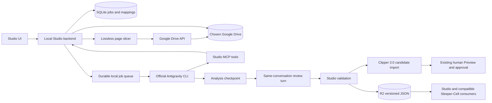

# PRD: Studio AntiGravity and Google Drive Image Clipper

**Version:** 1.1  
**Date:** 7 November 2026, Asia/Kolkata  
**Audience:** Claude AI and the developer implementing this repository  
**Status:** Implementation specification; the feature has not been implemented by this document  
**Required order:** Google Drive setup and verification first, then the remaining feature

## 1. Product outcome

Add a Studio-only **AntiGravity** navigation option beside the existing **Phone Status** area, which the user calls Mobile status.

The operator navigates through:

**AntiGravity → Series → Part → Workflow → Image Clipper → Chapters and pages**

Studio prepares source pages, uploads their slices to a chosen Google Drive account, and starts the official Antigravity CLI on the Mac. Antigravity obtains the images through MCP, generates crop pointers, and receives a separate review prompt in the same page conversation. Studio validates the final JSON, imports it into Image Clipper 3.0, and publishes it to R2 for Studio and compatible Sleeper-Cell consumers.

**Google Drive integration must be the first working milestone.** A sidebar and a disconnected Start button are not a completed first phase.

### 1.1 Locked user decisions

| Item | Requirement |
| --- | --- |
| Initiation | Only Studio initiates AntiGravity processing. |
| Execution | Official Antigravity CLI running locally on the MacBook. |
| Cloud managed agent API | Excluded. Do not introduce the Antigravity managed agent API or a direct Gemini API replacement. |
| Antigravity sign-in | Use its official existing account/session, with official interactive sign-in when necessary. |
| Drive account | The operator chooses the account through Google OAuth inside Studio setup. |
| Slicing and uploading | Studio performs both operations before Antigravity begins. |
| Drive root | `Manhwa Studio/<Series Name>/Chapters/<Chapter Folder>/`; create missing folders automatically. |
| Model | Operator selects an available model; each job records the requested and observed model identity. |
| Review | Studio sends a separate review turn back to the original page conversation. |
| Parallelism | Independent source pages can run concurrently with distinct conversation IDs. |
| Delivery | Validated crop-pointer JSON is published to Cloudflare R2. |
| Workflow nodes | Narration, Voiceover, Image Clipper, Metadata, Editor. Only Image Clipper is active. |
| Compatibility | Preserve existing Clipper 3.0, human review, cropping, Metadata, and Editor behavior. |

### 1.2 Implementation defaults

These defaults resolve unspecified choices; they are product decisions for v1, not claims about provider limits.

| Decision | Default |
| --- | --- |
| Drive destination | One active personal My Drive account per Studio installation; account switching is supported. |
| OAuth application type | Desktop app, appropriate to this local macOS application. |
| Drive permission | `drive.file`, plus `openid email` for displaying a verified account identity. |
| Part membership | Reuse current repository part logic; current Clipper grouping uses 20 chapters per part. |
| AI work unit | One original source page and all its slices, never one conversation per slice. |
| Slice height | Existing `SLICE_HEIGHT = 2048`, using lossless encoding. |
| AI concurrency | Start at 1; expose 1–4 configurable slots after parallel validation. Four is a product cap, not guaranteed quota. |
| Review model | Same selected model as analysis for the initial release. |
| Review correction budget | Up to 2 correction turns after the initial review; then require attention. |
| Human approval | Existing Studio Preview/manual review remains required before final cutting. |
| Automatic cleanup | Disabled. Retain Drive inputs and versioned results until explicit cleanup. |
| Background lifetime | Studio backend and runner stay running. Closing the Studio window may keep them alive; fully quitting Studio stops owned processes. |
| Phone compatibility | Explicit, versioned R2 consumer support; do not assume current phones understand new objects. |

## 2. Scope and success

### 2.1 Included

- Working Google Cloud/OAuth setup instructions and Studio connection UI.
- Account identification, token refresh, reconnect, disconnect, and missing-folder creation.
- Series → Parts → workflow navigation.
- Chapter/page listing backed by the real library and Clipper status.
- Selected-page preparation and optional combined Prepare & Start.
- Local CLI capability checks, sign-in guidance, dynamic model selection, and isolated job workspaces.
- Studio-owned MCP tools for retrieving Drive images and submitting analysis/review results.
- Durable jobs, separate page conversations, sequential analysis/review within each conversation.
- Progress, errors, pause, resume, stop, retry, interruption recovery, and bounded parallelism.
- Strict source/geometry validation, Clipper import, and R2 publication.
- A documented and tested Sleeper-Cell retrieval/import contract.

### 2.2 Deferred

- AntiGravity execution of Narration, Voiceover, Metadata, or Editor.
- Antigravity managed cloud agents, browser-chat automation, or unofficial authentication.
- Fully offline inference or processing while the Mac is off.
- Multi-account Antigravity quota pooling or automatic account rotation.
- Google Shared Drives, arbitrary existing Drive folder browsing, and team tenancy.
- Automatic human approval, automatic production cropping of these candidates, or automatic Metadata/Editor dispatch.
- An independently installed macOS launch agent that survives a full Studio quit.

### 2.3 Completion criteria

The feature is complete when a user can connect an initially empty Drive account, prepare real pages, process them locally through Antigravity, review them through a follow-up turn, and retrieve matching validated results in Studio and a supported Sleeper-Cell build.

An uploaded file, a successful CLI exit, an AI sentence saying “saved,” or a mocked phone download is insufficient evidence of that outcome.

## 3. Existing repository contracts

The application is React/Vite/TypeScript with an Express/Socket.IO backend, Prisma/SQLite, sharp, an Electron macOS shell, and existing R2 services.

Important files to inspect before implementation:

| Existing path | Reuse or integration purpose |
| --- | --- |
| `client/src/components/Layout.tsx` | Sidebar; currently labels the relevant item Phone Status. |
| `client/src/App.tsx` | Add AntiGravity routes. |
| `client/src/lib/api.ts`, `client/src/lib/socket.tsx` | Typed API and live progress conventions. |
| `client/src/lib/clipperParts.ts` | Existing 20-chapter grouping and part helpers. |
| `client/src/hooks/useSeriesOrder.ts`, `useSeriesProcess.ts` | Series ordering and production facts. |
| `client/src/pages/clipper3/Clipper3Library.tsx` | Series completion presentation. |
| `client/src/pages/clipper3/Clipper3SeriesView.tsx` | Chapter summaries and existing cloud panel integration. |
| `client/src/pages/clipper3/Clipper3ImageList.tsx` | Page list, pointer status, previews, and redo behavior. |
| `client/src/pages/clipper3/Clipper3Preview.tsx` | Existing human review/correction flow. |
| `server/src/services/chapterManifest.ts` | Authoritative source-page inventory and order. |
| `server/src/services/clipper3/perImageSlice.ts` | Full-width 2048-pixel slicing. |
| `server/src/services/clipper3/perImageStore.ts` | Per-page normalized crop artifact and final storage. |
| `server/src/services/clipper3/processedSync.ts` | Geometry-only import and source checks. |
| `server/src/services/clipper3/pageRedo.ts` | Explicit regeneration of an existing page. |
| `server/src/services/clipper3/chapterReview.ts`, `chapterCrop.ts` | Final approval and cutting authority. |
| `server/src/services/clipper3/metadataSplit.ts` | Metadata follows human review and verified cutting. |
| `server/src/services/managedCropProjection.ts` | Existing managed/mixed-page authority and write restrictions. |
| `server/src/services/chapterPageReplacement.ts`, `libraryControls.ts` | Source replacement and restart revisions. |
| `server/src/services/seriesActivity.ts` | Coordination with other work and destructive library actions. |
| `server/src/services/r2Service.ts`, `phoneCropImport.ts` | R2 configuration, transport, naming, and legacy import behavior. |
| `server/src/routes/cloudClipper.ts`, `client/src/pages/clipper3/CloudClipperPanel.tsx` | Existing alternative cloud workflow; inspect for reusable preparation/import logic. |
| `server/src/services/targetPackageProtocol.ts` | Existing sliced-page prompt/identity conventions; inspect before reuse. |
| `server/prisma/schema.prisma` | Additive persistent settings, jobs, attempts, mappings, and delivery state. |
| `server/src/index.ts` | Router registration, progress notifications, startup/shutdown. |
| `desktop/main.cjs` | App lifecycle, system browser, login-shell PATH, backend ownership. |
| `docs/clipper-metadata-split-v51.md` | Pointer-only clipping and manual approval boundaries. |

**Do not replace the existing cloud workflow with AntiGravity.** Share small pure helpers where useful while preserving its behavior.

The checkout contains substantial existing modified and untracked work. Inspect it in place; do not reset, clean, overwrite, or broadly reformat unrelated changes. No application changes were made while writing this PRD.

The existing generic Settings GET returns stored setting values. Therefore new OAuth secrets and user tokens must not be stored in that generic readable settings bag.

## 4. Phase 1: Google Drive setup first

### 4.1 First deliverable

Create a minimal **AntiGravity → Settings → Google Drive** entry point before implementing the rest of the workflow.

The first phase must independently demonstrate:

1. Valid OAuth client configuration is saved.
2. The operator chooses and authorizes the intended Google account.
3. Studio displays that account identity.
4. Studio creates or finds its own `Manhwa Studio` root.
5. A small test image can be uploaded, downloaded, and verified by SHA-256.
6. Repeating setup reuses the same root and repeating a transfer does not duplicate it.
7. A backend restart retains a usable connection or clearly requests reconnection.

This phase does not require Antigravity, its models, MCP, or R2.

### 4.2 Google Cloud setup instructions to ship

Provide a short guided setup panel and a dedicated setup document. The following is performed once by the Google Cloud project owner:

1. Create or select a Google Cloud project for Manhwa Studio.
2. Enable **Google Drive API**.
3. Configure Google Auth Platform branding, support contact, audience, and data access.
4. For a personal account, use an appropriate external audience and add the intended account as a test user while testing.
5. Register the requested scopes.
6. Create an OAuth client of type **Desktop app**.
7. Download its OAuth client JSON and import it into Studio.

Studio can guide the operator and open official setup pages; it cannot manufacture an OAuth registration or complete Google consent on the operator's behalf. [Google consent configuration](https://developers.google.com/workspace/guides/configure-oauth-consent)

For this local installed application, use the desktop authorization flow with PKCE and a loopback callback in the system browser. Treat downloaded desktop client secrets as public-client configuration, not as a security boundary. Do not require a public callback domain. [Google desktop OAuth](https://developers.google.com/identity/protocols/oauth2/native-app)

If the app is later distributed as a hosted web service, that is a separate deployment/authentication design and must not silently change this phase.

### 4.3 Studio connection UI

| Field or action | Behavior |
| --- | --- |
| Import OAuth Client JSON | Accept a Desktop OAuth configuration; validate structure and client type; never echo the whole imported document. |
| Client ID | Display the saved public client ID and configuration status. |
| Connect Google Drive | Begin account selection in the system browser. |
| Connected account | Show verified email and connection state. |
| Storage | Show available account storage information when obtainable; explain unavailable readings without blocking otherwise valid access. |
| Root folder | Show `Manhwa Studio`, its Drive link, and verification status. |
| Test connection | Run the bounded upload/download test using an app-owned fixture. |
| Reconnect | Reauthorize the same account when refresh fails. |
| Switch account | Require stopping/draining active work first; retain separate mappings for the old account. |
| Disconnect | Revoke/remove Studio's local Drive connection, preserving uploaded files and historical jobs. |

Connection states: `not_configured`, `disconnected`, `connecting`, `connected`, `reconnect_required`, `error`.

Model selection and Antigravity login must not be prerequisites for connecting Drive.

### 4.4 Authorization and credentials

Proposed implementation requirements:

- Generate per-request OAuth state, a PKCE verifier/challenge, and a short-lived request record.
- Run a temporary callback listener bound to `127.0.0.1` on an available port. Keep it separate from any LAN-exposed Studio API binding.
- Request `https://www.googleapis.com/auth/drive.file` and `openid email`. Verify the returned account identity and granted scopes.
- The scope choice supports Studio-created files without requesting access to the user's entire Drive. [Drive scope documentation](https://developers.google.com/workspace/drive/api/guides/api-specific-auth?hl=en)
- Validate callback state, finish the authorization-code exchange, and close the temporary listener after completion or a 10-minute timeout.
- Open Google authorization in the system browser rather than an embedded Electron login view.
- Keep access tokens in backend memory where possible. Persist refresh tokens through macOS Keychain, referenced by an opaque ID in the database.
- Use a Node-compatible secure credential adapter that works when Studio is launched from Finder and when its backend runs directly. Never silently fall back to plaintext if Keychain access fails.
- Keep OAuth configuration outside tracked source and browser storage. Redact it from logs, errors, job manifests, and exports.
- Refresh on demand with one refresh operation per connection at a time. Retain an existing refresh token when a refresh response omits a replacement.
- Return sanitized connection information only. Do not pass Google tokens to Antigravity or place them in MCP config files.
- Disconnect should invalidate local credentials immediately, attempt official revocation, and explain a failed remote revocation if the network is unavailable.

These storage requirements follow Google's guidance for protecting user tokens. [OAuth credential handling](https://developers.google.com/identity/protocols/oauth2/resources/best-practices)

An external OAuth app left in Testing can receive refresh tokens that expire after seven days when Drive permissions are requested. Ship a reconnect state and setup guidance instead of promising permanent authorization. [Google token expiration behavior](https://developers.google.com/identity/protocols/oauth2)

### 4.5 Folder creation and account identity

Create the hierarchy lazily:

```text
My Drive/
└── Manhwa Studio/
    └── <Series Name>/
        └── Chapters/
            └── <Exact Chapter Folder>/
                └── <Original Page Stem>__<Source Hash Prefix>/
                    ├── handoff.json
                    ├── crop-prompt.txt
                    ├── review-prompt.txt
                    ├── <Page Stem>_slice-01.webp
                    ├── <Page Stem>_slice-02.webp
                    └── ...
```

- The user does not need to create any folders beforehand.
- The first verified connection creates only the root; preparation creates series/chapter/page folders as needed.
- Preserve the user's requested Series → Chapters layout. Part numbers belong in manifests and UI; do not add a Part folder.
- Use exact source chapter-folder names, including padding and decimal chapter names, rather than rebuilding them from numeric labels.
- Folder IDs are authoritative. Store mappings keyed by OAuth client/account identity, folder kind, and stable library identity.
- Names are presentation. Series with identical display names must remain distinct by stable IDs and app-owned metadata.
- Set bounded `appProperties` for Studio identity, entity identity, and source generation. Use ID-based parents and app-owned lookup rules.
- Serialize creation per mapping. Persist a create intent and preallocated Drive file ID where supported, so an uncertain create response can be reconciled by ID.
- A manually created same-name folder outside `drive.file` visibility must not cause broader Drive access to be requested. Explain a visible duplicate if necessary and retain Studio's verified root.
- A missing, trashed, or inaccessible saved folder triggers a targeted repair/recreate action. Never silently upload to some other user's root.
- Switching accounts creates/reuses that account's hierarchy. Old jobs retain their original connection and file references.

Drive folders are created through file operations with explicit parent IDs. [Drive folder API](https://developers.google.com/workspace/drive/api/guides/folder)

### 4.6 Upload and download behavior

- Upload exact verified lossless slice bytes; set the correct image MIME type.
- Persist transfer state and remote IDs before marking preparation complete.
- Use resumable transfers for large slices or interrupted uploads; small-file multipart transfer is acceptable.
- On uncertain success, reconcile the existing upload instead of blindly creating another file.
- Check byte size and available remote checksums; use a test download to verify content SHA-256 where remote checksum support differs.
- Production retrieval also validates downloaded bytes against the handoff manifest.
- Handle token refresh, per-request timeouts, bounded retries, network loss, access denial, and exhausted Drive storage distinctly.
- The test fixture is created only when Test connection is selected. Delete or trash only its exact app-owned IDs afterward; preserve real input folders.
- Cancelling preparation retains completed uploads and their mappings for a later resume.

Google documents multipart and resumable upload mechanisms. [Drive uploads](https://developers.google.com/workspace/drive/api/guides/manage-uploads)

### 4.7 Drive pricing and quota presentation

Do not label the integration “unlimited free.” Standard API use is currently available without extra API charges within Google's published thresholds, while over-quota billing changes have been announced. Storage allowance is separate. Queue/backoff behavior and a visible account-storage error are required. Avoid hardcoded promises about future pricing. [Drive limits and pricing](https://developers.google.com/workspace/drive/api/guides/limits)

### 4.8 Phase 1 acceptance gate

Record evidence for an initially empty authorized account:

- OAuth browser sign-in succeeds; the displayed account is the chosen account.
- `Manhwa Studio` appears in that account and its saved ID survives a restart.
- Test image upload → download produces identical SHA-256.
- Repeating tests does not duplicate the root or reuse another account's file ID.
- Expired access-token refresh works; revoked authorization shows Reconnect required.
- Denied consent leaves Studio disconnected.
- Invalid callback state is rejected.
- Client secrets, access tokens, refresh tokens, authorization codes, and raw callback URLs are absent from API responses and logs.

Use mocked provider tests first, then record a real operator-authorized test. If Google Cloud setup or consent is unavailable, report that specific missing input; do not mark this gate passed.

## 5. Local Antigravity connection and model setup

### 5.1 Verified baseline, not an end-to-end certification

Read-only inspection on 7 November 2026 found an `agy` executable reporting **1.5.2** on this Mac. Its local help lists `--print`, `--conversation`, `--model`, `--output-format`, `--settings`, and MCP management.

No account login, model entitlement, image-processing request, MCP retrieval, or real generation was tested during PRD creation. Claude must verify those capabilities on the installed version.

### 5.2 Connection UX

Add **AntiGravity → Settings → Local Antigravity**:

- Detected executable and version; optional executable picker if detection fails.
- **Check connection** with separate installed/authenticated/MCP/image-capable indicators.
- **Sign in** guidance that launches the official CLI's interactive flow when required.
- **Refresh models** and a model dropdown populated from the signed-in installation.
- Analysis/review model, reasoning level when supported, concurrency, and timeout controls.
- Status explaining that the Mac must be awake and online and the Studio backend must be running.

Drive authorization grants storage access. Antigravity authorization permits AI processing. These may use the same Google account or different accounts because the Studio MCP service uses Studio's Drive connection.

Reuse a valid official Antigravity session when available. If it is missing, use official browser sign-in through the CLI. Studio must not request an Antigravity password or implement its own Google token exchange for Antigravity. [Antigravity authentication](https://antigravity.google/docs/install)

### 5.3 Required compatibility proof

Before production processing is enabled, verify:

1. Installed CLI version and supported options are recognized.
2. An official signed-in account can execute a bounded test turn.
3. Available model IDs can be obtained and a selected model can be explicitly requested.
4. Studio's isolated workspace configuration loads the intended MCP server.
5. An MCP tool can return an actual image that the selected model can inspect.
6. A synthetic visual test produces a result dependent on image content, not filenames or metadata alone.
7. A completed turn yields a recoverable conversation ID.
8. A second turn resumes that exact conversation and retains the relevant context.
9. Denied tools, malformed output, quota errors, and cancellation are detected correctly.

Record a compatibility report with CLI version, model, tested transport, image-delivery method, and timestamps. CLI upgrades invalidate the relevant cached proof until a short recheck succeeds.

Do not silently substitute a managed cloud API, a browser bot, a different provider, or a text-only approximation if this proof fails.

### 5.4 Model identity

Use the installed CLI's model listing and explicit model option. Persist:

- Requested model ID and display label.
- Requested reasoning level, if supported.
- Model reported by the runner/CLI initialization, when exposed.
- CLI version and effective configuration fingerprint.
- A clear `unknown` value if the actual served identity cannot be verified.

Do not present the requested model as independently verified when the CLI only reports the request. Detect known alias/deprecation replacements and require an explicit new selection if the configured policy cannot preserve the selected model.

The CLI documents model pinning and machine-readable execution; integration must be tested against the local version. [CLI reference](https://antigravity.google/docs/cli/reference/)

### 5.5 Runner lifecycle

- Execute child processes with argument arrays and `shell: false`.
- Resolve PATH in Finder-launched Studio using the existing desktop conventions.
- Use one isolated working directory per page attempt; retain it across that attempt's review turns.
- Do not run the agent with the production repository as its writable working directory.
- Configure only the required Studio MCP tools and permitted workspace reads/writes for the job. Account for inherited global MCP/plugin settings and verify the effective tool set.
- Keep credentials in the CLI's own official credential store; Studio stores only sanitized connection metadata.
- Antigravity's desktop application does not need to be open.
- AI model requests still use Antigravity's online service; local execution describes the runner/tools, not offline model inference.
- Closing the Studio window may continue work under the existing Electron lifecycle. Fully quitting Studio stops its owned backend/runner and records interrupted work.
- Sleep/network loss must not publish a half-finished result or silently restart a duplicate conversation.

## 6. Studio screens and navigation

### 6.1 Routes

Proposed routes:

| Route | Screen |
| --- | --- |
| `/antigravity` | Series list |
| `/antigravity/settings` | Drive, local Antigravity, prompts, and processing defaults |
| `/antigravity/series/:seriesId` | Parts for one series |
| `/antigravity/series/:seriesId/parts/:partNumber` | Workflow diagram |
| `/antigravity/series/:seriesId/parts/:partNumber/image-clipper` | Chapters and pages within that part |
| `/antigravity/runs/:runId` | Durable run detail, progress, errors, and delivery |

Add breadcrumbs and back navigation at each level. Deep links and refresh must reconstruct the same scope from persistent data.

### 6.2 Series and parts

- Reuse the canonical library, stable series IDs, cover/title, and saved ordering.
- Display available chapter count and pointer completion totals.
- Show an empty state for a series with no downloaded source pages.
- List Part 1, Part 2, Part 3, etc., with chapter ranges and availability.
- Reuse current part-membership helpers and represent missing/deleted/archived chapters honestly.
- A part can be viewed even when an earlier part is unfinished; source/preparation gates determine whether pages can be processed.
- Do not reinterpret existing production “Part complete” rules just for AntiGravity.

### 6.3 Workflow screen

Render these five nodes in sequence:

**Narration → Voiceover → Image Clipper → Metadata → Editor**

Image Clipper is clickable. Other nodes show **Coming Soon** and are disabled as actions. Add accessible labels, keyboard navigation for the active node, and a responsive layout.

The diagram is a module navigator. It does not require the disabled Narration/Voiceover nodes to finish before clipping, and it does not automatically invoke existing Metadata/Editor automation.

### 6.4 Chapter/page view

Show only chapters belonging to the selected series and part.

Each chapter exposes:

- Exact chapter label, source availability, page count, and pointer completion count.
- Expandable pages with source filename/index and thumbnail.
- Checkboxes to choose eligible pages or entire chapters.
- Separate Clipper pointer status, AntiGravity job stage, human review, and final crop status.
- Links to the existing Clipper Preview and the relevant run details.

Each page shows:

- Pending/Done pointer state using the existing Clipper 3.0 facts.
- Preparation/processing/delivery status when an AntiGravity job exists.
- Model, conversation ID, attempt number, and last error in expandable detail.
- Retry or Review again when applicable.
- A protected explicit redo path for replacing saved pointers.

Do not label an already completed phone-produced page “Pending” merely because AntiGravity has never run on it.

### 6.5 Controls

| Control | Required behavior |
| --- | --- |
| Select unfinished pages | Select eligible pages without current valid pointers. |
| Prepare selected | Slice and upload only; never begin an AI run implicitly. |
| Start process | Process prepared selected pages. If preparation is needed, offer an explicit combined Prepare & Start with its scope shown. |
| Pause | Stop dispatching new page jobs; in-flight page pipelines may finish. |
| Resume | Resume the same run's remaining eligible jobs. |
| Stop | Cancel queued work, request termination of owned in-flight processes, and invalidate result acceptance for cancelled attempts. |
| Retry failed | Retry failed stages only; retain valid prepared inputs and completed pages. |
| Review again | Send an additional review turn to that page's stored conversation, with the current candidate JSON and optional operator feedback. |
| Open Drive | Open the verified folder for the selected page/chapter. |
| Preview in Clipper | Open the normal human correction/review experience. |

Before starting, display account destination, series/part, selected chapter/page counts, model, concurrency, and any skipped/protected pages.

Disable Start with a specific reason when Drive, source files, prompt pack, model, MCP capability, or R2 configuration is missing. Preparation may work before Antigravity/R2 are configured.

## 7. Architecture and responsibility



| Component | Owns |
| --- | --- |
| Studio UI | Setup, selections, model choice, progress, retry, human review entry points. |
| Studio backend | Source identity, slicing, Drive credentials/transfers, persistent queue, CLI orchestration, validation, import, and R2 publication. |
| Antigravity CLI | Visual reasoning and requested analysis/review using its official account. |
| Studio MCP server | Job-scoped context/image access and structured checkpoint submission. |
| Google Drive | Input slices, manifests, and prompt snapshots. |
| R2 | Versioned validated result delivery and bounded discovery indexes. |
| Existing Clipper/Metadata services | Human approval, final cuts, approved-cut metadata and Editor readiness. |
| Sleeper-Cell adapter | Download/validate/import supported candidate JSON without inventing approval. |

**MCP does not initiate a task.** The local backend starts the CLI and sends each analysis/review turn. MCP supplies the tools used during those turns.

## 8. Preparation, page identity, and slice manifest

### 8.1 Source invariants

Take source inventory from `getChapterManifest`. For each page bind:

- Stable series/chapter identity and exact source folder/filename.
- Original page index in the canonical manifest.
- Original encoded-file SHA-256, decoded width/height, and orientation policy.
- Current library restart revision, page-replacement revision, and explicit redo revision.
- Current pointer fingerprint/absence, human-review authority, and managed ownership.

Revalidate these identities before upload completion, before analysis/review acceptance, and before import/publication. Changed sources produce a stale result, not a valid result for the new page.

Managed or mixed chapters remain blocked unless the existing managed authority explicitly supports the new provider. Use existing guards; do not convert them into unmanaged files to bypass ownership.

### 8.2 Slicing

- Reuse the existing full-width slicing algorithm and 2048-pixel default.
- The last slice takes the remaining height.
- Never resize, stretch, add overlapping bands, remove page content, or rotate without recording a supported transform.
- Record original offsets, slice width/height, byte sizes, and SHA-256.
- Verify slices cover the complete decoded source without gaps or overlaps.
- Decode slices and compare pixels with the corresponding original regions before marking the handoff verified.
- Keep all slices from the same original page in the same job/conversation.
- Compute limits for the selected model/tool transport. If an input is too large, stop that page with an actionable reason; never truncate its slice list silently.

### 8.3 Handoff shape

Reuse the existing `handoff/1.0` conventions where compatible. Keep provider/job delivery references in a separate versioned wrapper if adding fields would break strict existing validators.

Required logical fields:

| Group | Fields |
| --- | --- |
| Schema | Schema version, job ID, creation time, manifest hash. |
| Source | Series/chapter IDs and labels, original filename/page stem, page index, original hash, width, height, format, orientation. |
| Generations | Library restart, page replacement, redo revision, source-generation hash. |
| Slicing | Mode, slice height, lossless encoding, ordered slice inventory. |
| Each slice | Stable slice ID, filename, x0/y0/x1/y1, width/height, byte size, SHA-256. |
| Drive wrapper | Connection ID, verified root/chapter/page folder IDs, each slice file ID, transfer verification state. |
| Prompt wrapper | Analysis/review template version and hash; rendered prompt hash. |
| Verification | Coverage and pixel verification timestamps/results. |

Store manifest snapshots locally and in Drive. Do not include account refresh tokens, Antigravity credentials, R2 secrets, local private filesystem paths, or reusable signed URLs in shared manifests.

Page stems that look identical must still map to different jobs when source identity differs. Reject ambiguous source manifests rather than using a numeric suffix heuristic to attach a result.

## 9. Prompt pack and processing contract

### 9.1 Existing instructions remain authoritative

The user requested the current Crop Pointer prompt and review instructions. Follow-up read-only tracing on 7 November 2026 located the relevant builders in the paired checkout `../MAPI/Sleeper-cell-main`, branch `v2`, at `/Users/abhishekkandulna/Documents/Visual Studio/MAPI/Sleeper-cell-main`. Read that repository's `AGENTS.md` before working there.

Verified source locations, relative to that checkout:

| Purpose | Source |
| --- | --- |
| Classic geometry-only Crop Pointer prompt | `app/src/main/java/com/sleepercell/browser/clipper/GeometryWorkflow.kt:29` — `prompt(h: Handoff)`. |
| Geometry-only Review prompt | `app/src/main/java/com/sleepercell/browser/clipper/CropReview.kt:298` — `geometryReviewPrompt(...)`. |
| Shared continuity and adjacent-crop audit rules | `app/src/main/java/com/sleepercell/browser/clipper/CropSceneRules.kt:4` — `continuity` and `review`. |
| Bundled Crop Rules default | `app/src/main/java/com/sleepercell/browser/data/BrowserDatabase.kt:341` — `CROP_RULES_PROMPT`. |
| Actual Crop Rules lookup | `app/src/main/java/com/sleepercell/browser/clipper/ClipperPage.kt:590` — loads the fixed/preferred matching Prompt Library entry from the phone database. |
| Classic prompt assembly | `app/src/main/java/com/sleepercell/browser/clipper/ClipperPage.kt:310` — prepends saved Crop Rules to `GeometryWorkflow.prompt` through `HandoffFormat.withRules`. |
| Classic same-conversation review selection | `app/src/main/java/com/sleepercell/browser/clipper/ClipperPage.kt:324` and `autorun/ClipperRun.kt:974` — validator correction or geometry review, then the next turn in the existing chat. |
| Four-stage inventory and corners prompts | `app/src/main/java/com/sleepercell/browser/clipper/ClipperSteps.kt:250` and `:301` — `inventoryPrompt` and `geometryPrompt`. |
| Actual crop inspection prompt | `app/src/main/java/com/sleepercell/browser/clipper/GeometryWorkflow.kt:41` — `inspectionPrompt`. |
| Four-stage review/image assembly | `app/src/main/java/com/sleepercell/browser/clipper/ClipperPage.kt:262` — `nextStep`, including rendered crop previews and annotated-source review. |

The effective Crop Rules text is user-editable on the phone: SQLite `sleeper_cell.db`, table `prompts`, entry titled `Crop Rules`. The bundled constant is the seed/default, not proof of a particular phone's currently saved text. Preserve/export that entry if exact device-specific parity is required.

These are current source-code findings, not verification of the APK or prompt database installed on a live phone.

The repository contains multiple prompt variants, including `defaultPrompt` in the cloud route and `targetPackagePrompt` in a managed-protocol service. Neither is automatically the correct complete production prompt/review pack for this feature.

Provide **Analysis prompt** and **Review prompt** settings with View/Edit/Save and version history. Import or seed the verified current templates. If the canonical text cannot be found, support explicit paste/import and keep Start disabled until both templates are saved; do not invent a generic replacement and call it the existing prompt.

Port the verified builders and their data/schema requirements rather than copying one rendered example with placeholder page IDs. The current geometry review uses `clipper-review-geometry/1.0` with review revision, complete crop keys, split/merge lineage, removed keys, reviewed checks, and sweep evidence. Preserve those semantics in the Antigravity adapter. Classic and four-stage image/inspection behavior differ; record the selected prompt-pack variant and adapt only provider/tool delivery wording.

For each run:

- Snapshot both templates, variables, versions, and hashes.
- Inject the actual page identity, slice ordering/offsets, output contract, and allowed MCP tools.
- Snapshot optional operator instructions separately from fixed geometry/identity rules.
- Persist the rendered prompts for reproducibility.
- Editing settings affects future jobs only.
- Repair turns retain the original prompt snapshot and add bounded validation feedback.

Narration, story association, and production metadata remain outside the AntiGravity module's active scope. Internal visual notes used to evaluate candidates must not fabricate completed Metadata outputs.

### 9.2 Analysis

The runner starts a fresh conversation for one original page. Antigravity:

1. Obtains its assigned page context.
2. Fetches and visually inspects every required slice.
3. Finds illustrated shots using the saved crop rules and continuous artwork across seams.
4. Returns structured analysis through `submit_analysis`.

The proposed analysis adapter accepts the existing `chatgpt-analysis/1.0` measurement convention where reusable: integer slice-local corner coordinates, exclusive bottom-right edges, source identity, page-inspection status, candidate IDs, visual evidence, and review flags.

The schema name may retain historical provider wording for compatibility. Store the real provider as `antigravity-cli` in provenance; do not mislabel the request as a ChatGPT call.

Studio validates syntax, identity, measurement ranges, and image-delivery completeness before recording an accepted analysis checkpoint. Analysis alone is not a final result.

### 9.3 Separate review turn

After an accepted analysis and a completed CLI turn:

1. Persist the candidate checkpoint and conversation ID.
2. Build the saved Review prompt with the candidate JSON, original slice references, source/manifest hashes, and validation or operator feedback.
3. Resume that exact conversation ID in the same job workspace.
4. Require the full review procedure from the saved prompt pack.
5. Receive `submit_review` referencing the specific analysis hash.
6. Validate the reviewed candidate and accept or request a bounded correction.

Use explicit conversation IDs, never “continue the latest conversation.” The latter is unsafe when pages run in parallel.

The CLI supports explicit conversation continuation in headless execution. Its process success must still be checked against accepted MCP checkpoints and current job state. [Headless execution and continuation](https://antigravity.google/docs/cli/headless/)

If the current prompt pack calls for inspection of actual crop previews and annotated source audits, supply and require those steps. A text-only self-review must not substitute for them.

If the original conversation is unavailable, show a recoverable error. A new conversation requires an explicit restart/recovery action, resends the complete relevant inputs, and records a new attempt; do not claim context was retained.

### 9.4 Human review boundary

“AI reviewed” means Antigravity completed its configured second pass. It does not mean:

- The operator reviewed the chapter.
- `chapterReview` is approved.
- The chapter is already cropped.
- Metadata or Editor prerequisites are complete.

Import AI-reviewed geometry as candidates with human approval pending. The operator uses the existing Preview flow to correct and approve them, followed by the existing Crop Sections action.

## 10. Studio-owned MCP tools

### 10.1 Transport and authorization

Implement a local stdio MCP server owned by this feature. Configure it in the isolated job workspace, using supported version-checked settings. A job-scoped loopback bridge to the Studio backend is acceptable for accessing credentials and current job state.

The CLI supports local stdio MCP servers and workspace definitions. Verify actual effective configuration rather than modifying the user's global setup. [Antigravity MCP configuration](https://antigravity.google/docs/mcp)

The MCP service performs Drive downloads through Studio's authorized connection. This avoids requiring a second Drive OAuth integration inside Antigravity.

- Bind each MCP process/session to one active attempt and an expiring, revocable capability.
- Do not expose Google tokens or broad arbitrary Drive search/download tools.
- Requests must resolve against the persisted allowlist of that job's file IDs and original source identity.
- Expired, cancelled, superseded, or mismatched attempts cannot submit results.
- A model-supplied job ID does not establish authorization.
- Serve only the expected job files and previews, with bounded payload sizes.
- Keep protocol stdout clean; diagnostics go to redacted stderr.

### 10.2 Tools

These are proposed application tool names, not pre-existing Antigravity APIs:

| Tool | Input and purpose | Backend enforcement |
| --- | --- | --- |
| `get_job_context` | Return bound page identity, ordered manifest, prompt snapshots, current stage, and source references. | Active attempt and allowed stage. |
| `fetch_slice` | Request one registered slice ID; return the verified image plus its dimensions and source offset. | Download from the recorded Drive file ID; check hash and record successful delivery. |
| `submit_analysis` | Submit schema-checked candidates for this page. | All required slices delivered, exact source/manifest, valid geometry, active analysis stage. |
| `get_review_context` | Return the pinned review prompt and accepted analysis checkpoint. | Correct analysis hash and review stage. |
| `fetch_crop_preview` | Obtain the actual temporary crop for a validated candidate ID. | Render only from this source and accepted candidate; verify current source hash. |
| `fetch_source_audit` | Obtain source slices/overviews annotated with the current candidate bounds when required by the prompt pack. | Bound candidate revision and source, with an unannotated view also available. |
| `submit_review` | Submit reviewed candidates, analysis hash, checks performed, flags, and completeness. | Required assets delivered for this review, valid output, matching generation and accepted analysis. |

MCP supports image content in tool responses, but support by the selected CLI/model path must be proven with an image test. Returning only a Drive link or file metadata does not prove the model saw the image. [MCP tool result types](https://modelcontextprotocol.io/specification/2025-11-25/server/tools)

Use full-resolution slices where practical. If display conversion to PNG is needed, retain exact decoded pixels and distinguish transport-encoding hashes from original Drive-byte hashes.

Review preview renders are temporary QA assets, not production `crops3/` outputs and not an automatic approval.

### 10.3 Result checkpoints

Persist accepted analysis/review submissions atomically. Duplicate submission of the same stage/hash is idempotent. A different submission after stage acceptance is a new review/correction revision, not an overwrite of the accepted record.

Require an accepted review checkpoint and current source identity before finalization. Do not rely on the assistant's final natural-language response to locate or trust files.

## 11. Geometry and output validation

### 11.1 Coordinate conversion

Measurements may use slice-local pixels. Final Clipper artifacts use normalized coordinates against the **original page**.

For each measured corner:

```text
originalX = slice.x0 + localX
originalY = slice.y0 + localY
normalizedX = originalX / sourceWidth
normalizedY = originalY / sourceHeight
```

Example: a 1000 × 3000 page has slice 1 at y=0 and slice 2 at y=2048. A crop whose top is slice 1 y=1900 and bottom is slice 2 y=152 spans original y=1900..2200. Its normalized y values are 1900/3000 and 2200/3000. It is one crop, not two crops split at the upload seam.

### 11.2 Required validations

- Strict JSON/schema types and bounded payload/candidate counts.
- Exact attempt, source, manifest, accepted analysis, and generation references.
- Original image filename/dimensions/hash match the current local source.
- All expected image assets were successfully delivered; report delivery separately from subjective visual correctness.
- Each referenced slice exists in the ordered manifest.
- Slice-local coordinates are finite, integral, and in bounds; exclusive right/bottom may equal width/height.
- Converted corners have positive width and height and stay inside the original page.
- Exactly four valid normalized corners per final crop.
- Unique candidate/crop IDs and deterministic ordering/IDs in the accepted output.
- No silently discarded bad crop entries or unannounced coordinate clamping.
- Empty crops are accepted only after an explicit complete visual no-artwork review, not because parsing failed.
- The selected v1 geometry mode is rectangles; preserve four-point formatting. Existing perspective artifacts stay readable but are not newly invented by this provider.
- Images exceeding supported transport/encoder limits fail explicitly rather than being reduced without notice.

Bounds and schema checks cannot guarantee visually correct crops. Pilot QA and final human review remain part of acceptance.

### 11.3 Canonical per-page JSON

The final pointer file must match the current geometry-only Clipper contract. Example with illustrative values:

```json
{
  "format": "four-point-crop",
  "version": "1.0",
  "workflow": "clipper-geometry/1",
  "sourceSha256": "<SHA-256 of the current original file>",
  "image": {
    "filename": "page_001.webp",
    "width": 1000,
    "height": 3000
  },
  "coordinateSystem": "normalized",
  "crops": [
    {
      "id": "crop-01",
      "reason": "illustrated_shot",
      "crop": {
        "mode": "rectangle",
        "points": [
          { "id": "P1", "x": 0.1, "y": 0.1 },
          { "id": "P2", "x": 0.9, "y": 0.1 },
          { "id": "P3", "x": 0.9, "y": 0.3 },
          { "id": "P4", "x": 0.1, "y": 0.3 }
        ]
      }
    }
  ]
}
```

Use actual current normalization helpers where compatible. Keep provider/model/conversation/review evidence in a separate envelope or sidecar so strict legacy readers are not forced to understand new fields.

Preserve per-page files as the source of truth. A chapter index may reference them; do not replace the page-local contract with one stitched chapter coordinate system.

## 12. Clipper import and existing-work protection

Stage the reviewed pointer file in the existing Processed layout:

```text
<Series>/Processed/<Exact Chapter Folder>/<Existing Page Folder>/
    crop-pointers-ch<Chapter>-p<Page>.json
```

Resolve page identity from the authoritative manifest and existing naming helpers. Never guess that every original filename is `page_NNN`; the library also supports other names.

- Validate first; use atomic temporary-write/rename.
- Use or extract the current geometry-only importer so `crop_points3/<Original Stem>.json` receives the canonical artifact.
- Keep metadata optional for `workflow: clipper-geometry/1`.
- Do not write fake metadata to make a page appear done.
- Preserve any saved human-reviewed pointers and existing output crops.
- If another provider/operator saved pointers after this job started, show a conflict and retain the new result as a candidate; do not replace the saved page.
- Regeneration uses the existing explicit page-redo lifecycle and revision checks.
- Preserve managed/mixed authority restrictions.
- Re-importing the same accepted result is a no-op.
- Imported pointer state updates the ordinary Clipper list and production facts through existing notifications.
- Existing chapter review and Cropped markers remain governed by the current review/cutter services.

An imported pointer can make the page's ordinary pointer status Done while human review and production cutting remain pending. Show those separate facts in AntiGravity.

## 13. Durable jobs, concurrency, and controls

### 13.1 Run and page state

A run is a user selection with pinned settings. A page job is the stable work unit; an attempt is one execution/recovery history for that unit.

| Page stage | Meaning |
| --- | --- |
| `pending` | Selected, but not prepared. |
| `preparing` | Verifying source and slicing. |
| `uploading` | Uploading/confirming registered Drive inputs. |
| `prepared` | All inputs and prompt snapshots are available and verified. |
| `queued` | Awaiting an available local worker slot. |
| `analyzing` | Initial CLI turn in progress. |
| `analysis_saved` | A valid analysis checkpoint was accepted. |
| `reviewing` | Separate review/correction turn in the same conversation. |
| `validating` | Checking reviewed candidates and producing final normalized JSON. |
| `delivering` | Importing locally and publishing the accepted version to R2. |
| `ready_for_human_review` | Current result imported and available on R2; human approval is pending. |
| `skipped_existing` | Existing valid pointers were preserved. |
| `retry_wait` | A retryable transfer/provider error has a scheduled retry. |
| `needs_attention` | Review flags, exhausted correction budget, ownership conflict, or unsupported capability needs operator action. |
| `failed` | A terminal attempt error with a specific recovery action. |
| `interrupted` | Process/backend lifecycle ended with unresolved work. |
| `cancelled` | Operator stopped the attempt and result acceptance is revoked. |
| `stale` | Source, authority, or configured input generation no longer matches. |

Store `stage` separately from run control and delivery status. Do not erase an accepted review checkpoint merely because R2 is temporarily unavailable.

Run controls: `draft`, `preparing`, `running`, `pause_requested`, `paused`, `stop_requested`, `stopped`, `completed`, `completed_with_errors`, `interrupted`.

Completion counters must distinguish success, existing/skipped, failed, cancelled, stale, and in-flight pages. Do not count a generated-but-unpublished page as fully delivered.

### 13.2 Persistence and idempotency

- Use durable SQLite records and atomically written versioned artifacts; do not use an in-memory Map as the job authority.
- Persist a transition/checkpoint before scheduling the next stage.
- Keep a bounded append-only operational event log with stable event sequence numbers.
- Use an idempotency key over series/chapter/page identity, original hash, source revisions, manifest hash, prompt-pack hashes, model/effort, and Drive connection identity.
- Store an explicit new-attempt identity for requested redo/reprocessing.
- Only one active owned attempt may process a given page/source generation.
- Double-clicking Start or replaying an HTTP request returns the same run/job when its idempotency key matches.
- Another run selecting an already owned page shows its existing job rather than dispatching another agent.
- Keep prior successful artifacts and attempt histories immutable.
- Release leases on terminal states, and verify ownership with attempt ID, lease epoch, worker instance, and process identity when recovering.

### 13.3 Parallelism

- One worker slot owns one source-page pipeline through analysis/review.
- Different pages have independent conversation IDs, workspaces, MCP capabilities, and output paths.
- Analysis and review within a conversation are serialized.
- Do not send concurrent prompts into the same conversation.
- Do not split a seam-crossing page across unrelated slice conversations.
- Use a separate bounded queue for Drive uploads/downloads and another for AI slots.
- Use a single publication coordinator per library to serialize discovery-index changes.
- Default AI concurrency is 1. After verification, allow the operator to select 1–4.
- Concurrency does not create extra provider quota; back off according to official account behavior rather than rotating accounts.
- Preserve chapter/page ordering from the canonical manifest when presenting or indexing results, regardless of completion order.

### 13.4 Pause, stop, and recovery

Pause stops new dispatch. In-flight page pipelines may finish their analysis/review/delivery stages and then release their slots; label this behavior in the UI.

Stop:

1. Atomically mark the run stopping and queued attempts cancelled.
2. Revoke active attempt result capabilities at a defined commit boundary.
3. Request termination of only the child process groups owned by that run.
4. Prevent late MCP responses or old callback events from committing.
5. Preserve artifacts already committed before Stop.
6. Retain completed Drive uploads and accepted checkpoints for a deliberate later retry.

Never kill all Antigravity processes on the Mac or terminate an unrelated interactive user session.

On restart:

- Recover saved state and reconcile pending transfer/publication intents.
- Determine whether an owned CLI process is still alive before dispatching replacement work.
- Mark unresolved AI attempts interrupted.
- Resume at a verified checkpoint only when conversation ID and stage are known.
- If dispatch outcome is uncertain, require an explicit recovery action instead of blindly sending the prompt again.
- Retry delivery without another AI request when the final reviewed JSON is already valid.
- Changing models/prompts/account applies to new attempts, not to previously accepted stages.

For v1, fully quitting Studio stops its owned backend and runner. A future separately supervised macOS service is outside this PRD's initial release.

### 13.5 Coordinating with other production work

Register AntiGravity work with the current series-activity and mutation guards.

- Source replacement, deletion, restart, archiving, manual redo, phone import, and human approval must invalidate or block conflicting active commits.
- Capture the current pointer fingerprint before dispatch and compare it again under the existing write authority before import.
- Do not hold a broad chapter write lock while waiting minutes for an AI response.
- Respect known phone/managed ownership. Where phone reservations are not shared, preserve the first current saved artifact and expose the other result as a conflict candidate.
- Do not claim distributed duplicate prevention until both desktop and phone implement the same reservation contract.
- Cleanup/delete operations must include AntiGravity references and make delayed jobs stale without deleting unrelated Drive content.

## 14. R2 publication and consumer contract

### 14.1 Publishing owner and readiness

Studio's backend uploads the accepted JSON using existing R2 configuration and transport helpers. Antigravity does not receive R2 credentials or directly control bucket keys.

Validate/import and R2 publication are independent durable delivery targets. A local import success must survive an R2 error, and an R2 retry must reuse the saved reviewed artifact.

Before Start, require valid R2 configuration and an explicit configured destination prefix. Preparation can still be used without it.

R2 supports object upload/download through its S3-compatible API; use the repository's existing client/configuration rather than creating a second credential form. [R2 API support](https://developers.cloudflare.com/r2/api/s3/api/)

### 14.2 Versioned namespace

Do not overwrite the phone-owned `crops/<Series>/<Chapter>.zip` protocol or publish raw candidates as approved metadata jobs.

Proposed new namespace:

```text
<prefix>shared/antigravity-crops/
    <seriesId>/<chapterId>/
        index.json
        results/<sourceGenerationHash>/<attemptId>/
            <pageStableId>/crop-pointers.json
            <pageStableId>/result.json
```

`<prefix>` must be the configured shared exchange prefix resolved consistently by desktop and phone. Reuse existing prefix discovery only if its semantics are proven; do not publish duplicate copies across every guessed prefix.

- IDs are safe encoded segments, not user-supplied bucket paths.
- Display titles and exact source folder names travel inside validated envelopes.
- Immutable attempt paths prevent an older attempt from overwriting newer output.
- Publish the raw pointer object and result envelope before updating the chapter discovery index.
- The index is the commit pointer; a consumer must not treat an unindexed orphan upload as current.
- Use a serialized publisher plus a revision/conditional-write strategy supported by the installed R2 client/service.
- V1 has one active Studio publisher per shared library. A second publisher must not silently race to own the same index.
- Perform a targeted read-back or supported checksum verification on publication; retain the actual JSON content hash in delivery records.

### 14.3 Result envelope

Define and validate `studio-antigravity-crop-result/1` with:

| Field group | Required contents |
| --- | --- |
| Identity | Schema, Studio installation ID, result ID, run/job/attempt IDs. |
| Library | Stable series/chapter/page identities and exact folder/filename mapping. |
| Source | Original filename, page index, width/height, original SHA-256. |
| Generations | Restart, page replacement, explicit redo, and source-generation hash. |
| Prompt provenance | Analysis/review template hashes and rendered prompt hashes. |
| Provider | `antigravity-cli`, CLI version, requested model, observed model or unknown, effort if available. |
| Result | Pointer object key, SHA-256, byte size, geometry schema/version, candidate count. |
| AI review | Accepted analysis/review hashes, completeness, unresolved flags, review round count. |
| Approval | `candidate_only`; never a forged human-approved or cropped state. |
| Time | Created, reviewed, validated, published timestamps in UTC. |

Do not expose refresh tokens, CLI credentials, raw authorization data, full local paths, or account email addresses in R2 provenance.

The chapter index schema `studio-antigravity-crop-index/1` must contain:

- Series/chapter identity and current source-generation snapshot.
- Monotonic publication revision and publishing Studio identity.
- Expected original-page inventory/order.
- Available result references and hashes per page.
- Explicit partial/complete state and stale/superseded entries.
- Updated timestamp.

If source pages are replaced or approved pointers are edited, supersede/revoke the advertised stale candidate reference. Retain immutable history, but do not advertise old geometry as the current authoritative result.

### 14.4 Studio collection

The producing Studio imports its accepted local result using the normal Clipper adapter. A separate Fetch results action can recover indexed R2 results after a local interruption or for a compatible Studio instance.

All retrieval paths apply the same schema/source/revision/ownership validation. Hash equality makes repeat imports a no-op.

Do not repeatedly LIST the bucket while a page runs. Use local job events for progress, existing relay notifications when applicable, and scoped explicit/reconnect fetches for R2 discovery.

### 14.5 Sleeper-Cell collection

The AntiGravity UI and processing trigger stay Studio-only. Phone consumption is a data-import capability:

1. Detect the versioned result notification or read a scoped index during an existing supported sync/fetch action.
2. Verify the index/envelope schema and result hashes.
3. Map the series, chapter, and exact original page against the local shared library.
4. Verify the phone's source bytes/revision match the published source identity.
5. Import pointer JSON as an AI-reviewed candidate only.
6. Preserve phone/Desktop human-approved geometry and newer local work.
7. Record an optional per-device import acknowledgement.
8. Leave final review/cutting/Metadata gates intact.

An offline phone catches up on reconnect/sync. Phone acknowledgement is shown separately from “available on R2”; an offline phone does not make a successful page-generation job fail.

**Compatibility gate:** the Android implementation is in the paired `../MAPI/Sleeper-cell-main` checkout, branch `v2`, rather than inside this Studio checkout. Inspect `app/src/main/java/com/sleepercell/browser/share/SharedCrops.kt`, `share/StudioCropSync.kt`, and `clipper/cloud/CloudClipperResult.kt` plus their callers/tests before choosing the adapter. Existing shared-page and cloud-controller formats are separate protocols; their existence does not establish support for the proposed AntiGravity namespace. Verify a real supported build before claiming phone collection works.

If a compatible existing shared-crop envelope is found, an adapter may publish that already-supported format instead. Document its exact schema and consumer source/test before replacing the proposed namespace. Preserve candidate-only approval semantics.

### 14.6 Scope boundary after publication

The new AntiGravity Metadata node remains Coming Soon. Existing manual review → Crop Sections → approved metadata-job publication may continue through the current application, but the AntiGravity run must not automatically invoke that sequence.

No cropped-image archives or production video assets are transferred by this new result protocol.

## 15. Proposed persistent data

Use additive Prisma models and validated string unions consistent with the installed SQLite/Prisma capabilities. The names below are proposed, not existing tables.

| Record | Required data |
| --- | --- |
| `DriveConnection` | ID, verified Google subject, display email, OAuth client ID/config reference, granted scopes, secret-store reference, root folder ID, status, timestamps, last sanitized error. |
| `DriveFolderMapping` | Connection/client identity, folder kind, stable library/page-generation identity, folder ID/parent ID, display name, create intent, verification timestamp. |
| `DriveInputFile` | Connection, job/generation, slice ID, Drive file ID, parent ID, name, MIME, bytes, SHA-256, upload session reference, upload/verification state. |
| `AntigravityPromptVersion` | Prompt kind, immutable version ID, content, hash, source/origin, created time; current pointer stored separately. |
| `AntigravityRun` | ID, series/part scope, selected page snapshot, pinned connection/model/prompt profile, concurrency, control state, counts, created/started/finished times. |
| `AntigravityPageJob` | Stable page/source/profile identity, idempotency key, manifest snapshot/hash, current stage, current attempt ID, preexisting pointer fingerprint, source revisions. |
| `AntigravityAttempt` | Attempt ID/number, conversation ID, workspace, CLI version, model evidence, lease epoch, process identity, checkpoint paths/hashes, retry/timeout/error data, cancellation state. |
| `AntigravityDelivery` | Result hash/version, local import state, R2 object/envelope/index keys and verification, separate phone acknowledgement facts, error/retry state. |
| `AntigravityEvent` | Sequence, entity IDs, stage, sanitized event type/message, timestamp, optional bounded details. |

Keep secret material out of Prisma's generic Setting values and out of public serialization. A secret reference is not a refresh token.

Required uniqueness/coordination rules:

- Folder identity unique within connection/client.
- Input slice unique within immutable page generation.
- One logical page job per idempotency key.
- One active page lease across overlapping runs.
- One accepted stage checkpoint per attempt/stage/revision.
- One delivery record per result hash/destination.
- Ordered events and indexed queries by series, chapter, run, stage, and updated time.

Migration must preserve the existing database and production files. Test against a copy of the current schema; do not use a destructive reset.

## 16. Proposed API surface

All paths are under the local Studio API. Return consistent typed data and sanitized errors.

### 16.1 Drive endpoints

| Method/path | Purpose |
| --- | --- |
| `GET /api/google-drive/status` | Sanitized connection, account display, root, config status, and last test. |
| `PUT /api/google-drive/oauth-client` | Validate/import local Desktop OAuth configuration; write securely. |
| `POST /api/google-drive/connect` | Create a state/PKCE session and return/open the official authorization URL. |
| `GET /api/google-drive/connect/:requestId` | Read only the requesting UI session's pending/completed/cancelled status. |
| `POST /api/google-drive/test` | Run the bounded app-owned image upload/download test. |
| `POST /api/google-drive/ensure-root` | Create/reconcile the app-owned root. |
| `POST /api/google-drive/disconnect` | Revoke/delete the selected local connection; preserve Drive data. |

The OAuth callback is received by the temporary loopback listener described in section 4, not by an unauthenticated arbitrary public callback.

### 16.2 AntiGravity endpoints

| Method/path | Purpose |
| --- | --- |
| `GET /api/antigravity/connection` | Installed version, sanitized auth/capability status, and compatibility report. |
| `POST /api/antigravity/check` | Check local prerequisites; run live capability tests only when explicitly selected. |
| `POST /api/antigravity/sign-in` | Start or guide official interactive CLI sign-in; no password fields. |
| `GET /api/antigravity/models` | List the actual available model choices. |
| `GET/PUT /api/antigravity/settings` | Nonsecret model/effort/concurrency/timeouts/defaults. |
| `GET/PUT /api/antigravity/prompts/:kind` | Load/save analysis or review template versions. |
| `GET /api/antigravity/series` | Ordered series with real pointer and run summaries. |
| `GET /api/antigravity/series/:id/parts` | Parts and chapter ranges. |
| `GET /api/antigravity/series/:id/parts/:part/chapters` | Part-scoped chapter/page inventory and statuses. |
| `POST /api/antigravity/preparations` | Prepare a validated selection and snapshot inputs. |
| `POST /api/antigravity/runs` | Idempotently start the exact prepared selection or explicitly combined preparation. |
| `GET /api/antigravity/runs/:id` | Durable run/job/checkpoint/delivery detail. |
| `POST /api/antigravity/runs/:id/pause` | Stop new dispatch. |
| `POST /api/antigravity/runs/:id/resume` | Resume remaining eligible work. |
| `POST /api/antigravity/runs/:id/stop` | Cancel/terminate only owned work. |
| `POST /api/antigravity/jobs/:id/retry` | Retry from an explicitly validated checkpoint. |
| `POST /api/antigravity/jobs/:id/review` | Review again with the same conversation and pinned current candidate. |
| `POST /api/antigravity/jobs/:id/publish` | Retry delivery only. |
| `POST /api/antigravity/results/fetch` | Scoped R2 discovery/import. |

Mutation bodies must contain stable IDs and optional scope checks, not trusted local paths, arbitrary Drive file IDs, arbitrary R2 keys, or shell commands.

Start/preparation response includes operation ID, created/reused job IDs, exact eligible selection, skipped/protected items, and blockers. Reject requests that include chapters outside the route's series/part.

Protect connection and mutation routes against untrusted origins and request forgery. Restrict the OAuth listener and job bridge to loopback; use per-session/per-job capabilities rather than relying on CORS alone.

### 16.3 Progress events

Proposed Socket.IO event: `antigravity:progress`.

Payload: sequence, run/job/attempt IDs, series/chapter/page identity, current stage, completed/total counts, last sanitized error, retry time, model evidence, and delivery states.

On reconnect, load a durable snapshot then reconcile newer event sequences. Never infer completion solely from a missed socket message.

Use local events for UI progress; a visible-page fallback may poll the local API at a modest interval. It must not trigger a new R2 LIST on every refresh.

## 17. Errors, limits, and recovery

| Condition | Required response |
| --- | --- |
| Drive API disabled or invalid OAuth client | Setup error with the relevant step; no AI dispatch. |
| User denies consent | Disconnected state; retain nonsecret setup. |
| Callback state/PKCE mismatch or timeout | Reject the session; no credential save. |
| Token expired | Refresh once through the connection's serialized refresh path. |
| Refresh rejected/revoked | Reconnect required; preserve jobs and uploaded inputs. |
| Drive account switched | Keep existing jobs pinned; require explicit preparation under the new connection. |
| Storage full | Pause preparation and identify the chosen account/storage issue. |
| Drive/R2 throttling | Honor available Retry-After, exponential backoff with jitter, bounded retries, and visible retry time. |
| Uncertain upload completion | Reconcile registered IDs/session before retrying creation. |
| CLI not found/unsupported | Connection setup error; preserve Drive feature functionality. |
| CLI auth required | Offer official sign-in; do not loop background browser launches. |
| Model removed/unavailable | Stop affected dispatch and ask for a new explicit model choice; no silent fallback. |
| Agent image/tool capability missing | Failed compatibility gate; no text-only substitute. |
| Required MCP tool denied | Mark incomplete/needs attention even if the process exits successfully. |
| Tool delivery/hash mismatch | Reject that asset/result; no import/publication. |
| Context or image limits exceeded | Fail the page clearly or use a separately verified full-page-preserving strategy. |
| Invalid JSON/geometry | Send bounded same-conversation correction feedback; retain prior checkpoint. |
| Review unresolved after budget | Needs attention; retain candidates and review flags. |
| Provider quota exhausted | Stop new dispatch for the affected account/model, show known reset time or manual retry; no quota circumvention. |
| CLI timeout/crash | Preserve checkpoints and reconcile process/conversation before recovery. |
| Studio quit/Mac sleeps | Interrupted/retryable state; no duplicate dispatch or late finalization. |
| Page source/revision changes | Stale, with old output retained as history only. |
| Another saved/human-reviewed result wins | Conflict candidate; preserve current approved work. |
| R2 fails after successful review | Delivery pending; retry upload without rerunning analysis. |
| Clipper import fails | Keep accepted result and separate import error; retry importer without AI. |
| Phone schema/build unsupported | Published result remains available, but phone handoff is explicitly unverified/unsupported. |
| Phone offline | Available on R2 with no acknowledgement; catch up later. |

Initial proposed operational bounds, configurable after measurement:

- OAuth session: 10 minutes.
- AI page deadline: 45 minutes including review; expose the configured deadline.
- Transfer retry attempts: 5 per operation, with jittered backoff and provider reset handling.
- Review correction turns: 2 after the first review.
- JSON size, image bytes, candidate count, slice count, preview dimensions, and log retention: explicit validated bounds chosen from observed source sizes and model/transport capability.

Do not hardcode a silent slice cap or shorten pages to fit a bound. A source that exceeds a bound must be visible as an error.

## 18. Privacy, access, and operational requirements

- Credentials stay in backend/official OS stores and never enter browser localStorage, generic settings JSON, prompts, R2 envelopes, or exported logs.
- The user sees the Drive destination account before preparation and the processing account/model where the CLI exposes it.
- OAuth browser consent, Keychain prompts, and official CLI sign-in remain real operator actions.
- Do not edit the user's global Antigravity model, MCP, or plugin configuration just to run a job.
- Restrict effective job tools; test whether global configuration is inherited and neutralize unrelated tools in the supported per-job configuration.
- Apply timeouts, input size limits, path confinement, generation checks, and result acceptance checks in backend code, not only in prompts.
- Logs capture stage, IDs, durations, model evidence, retries, and sanitized errors; do not require storing private model reasoning.
- Show local source/Drive/R2 retention separately. Disconnecting an account does not delete its uploaded files.
- An explicit cleanup preview inventories exact app-owned file IDs or versioned result keys before deletion; protect other series and same-name folders.
- Persist timestamps in UTC and display them using Studio/user timezone conventions.
- New processing must not block the UI event loop; bound sharp work, streaming transfers, subprocess output, and memory.
- Report observed throughput and visual correction rates from pilots. Do not promise a particular pages/minute or “pixel-perfect AI” quality.

## 19. Implementation organization

The following module organization is suggested. Claude may consolidate related files if ownership remains clear.

| Proposed path | Responsibility |
| --- | --- |
| `server/src/routes/googleDrive.ts` | Sanitized connection/config/test endpoints. |
| `server/src/services/googleDrive/oauth.ts` | PKCE, account identity, temporary callback, refresh. |
| `server/src/services/googleDrive/credentials.ts` | OS credential-store adapter and safe configuration access. |
| `server/src/services/googleDrive/files.ts` | Folder mapping, transfer intents, upload/download verification. |
| `server/src/routes/antigravity.ts` | Scope-checked run/settings/prompt/result endpoints. |
| `server/src/services/antigravity/cli.ts` | Detection, official login integration, model enumeration, subprocess adapter. |
| `server/src/services/antigravity/jobs.ts` | Persistent state machine, scheduling, ownership, retry/recovery. |
| `server/src/services/antigravity/preparation.ts` | Existing slicer adapter, source snapshots, Drive packages. |
| `server/src/services/antigravity/prompts.ts` | Versioned prompt pack, rendered snapshots, review messages. |
| `server/src/services/antigravity/mcp.ts` | Job-bound tools and typed checkpoint submission. |
| `server/src/services/antigravity/validation.ts` | Slice-local conversion, schema checks, final geometry. |
| `server/src/services/antigravity/delivery.ts` | Clipper adapter, R2 publication/index and delivery retries. |
| `server/src/services/antigravity/protocol.ts` | Shared schemas, envelopes, identity helpers, supported capabilities. |
| `client/src/pages/antigravity/` | Series, Parts, Workflow, Clipper, RunDetail, Settings views. |
| `client/src/components/antigravity/` | Connection cards, workflow nodes, page selection, progress and errors. |
| `client/src/hooks/useAntigravity.ts` | Durable snapshot + socket reconciliation. |
| `docs/antigravity-google-drive-setup.md` | Operator setup and reconnect guide. |
| `docs/antigravity-operations.md` | Local lifecycle, quota/errors, recovery, retention, compatibility. |

Add dependencies only when needed and use official maintained OAuth/Drive and MCP libraries after checking current documentation. Avoid introducing another frontend framework, database, cloud controller, or global service.

Extract small pure shared slicing/normalization helpers when existing code is coupled to another route. Do not import a whole controller with startup side effects just to reuse a prompt or conversion.

## 20. Phased execution plan for Claude

Phases are ordered delivery gates, not requests for repeated approval.

### Phase 1 — Working Google Drive integration

**Build first:** minimal settings entry, desktop OAuth import/setup, browser authorization, Keychain storage, account display, root mapping, and verified test transfer.

**Tests/evidence:** auth state/PKCE and refresh failures; no secrets returned; folder idempotency; account isolation; real upload/download hash match.

**Gate:** section 4.8 passes. If operator-owned Cloud configuration/consent is missing, finish this phase's implementation/tests/setup guide and identify the exact missing input. Do not claim real Drive setup or move production processing past this gate.

### Phase 2 — Local Antigravity/MCP feasibility slice

**Build:** CLI detection, official sign-in guidance, model listing/pinning, one isolated workspace, minimal scoped MCP tool, synthetic image test, accepted checkpoint, and same-conversation second turn.

**Tests/evidence:** actual image-dependent result, conversation resume, tool permission behavior, cancellation, model evidence, and sanitized compatibility report.

**Gate:** section 5.3 passes on the installed version. Keep the new Drive integration usable if a CLI capability is unsupported.

### Phase 3 — Studio browsing and workflow

**Build:** sidebar, series/parts, workflow nodes, part-scoped chapter/page listing, existing pointer/human/crop statuses, settings links, selections, and run detail shell.

**Tests/evidence:** correct part ranges, no cross-series selection, disabled Coming Soon nodes, reload/back/deep link behavior, canonical Done status.

**Gate:** real library fixtures render accurately and protected work is visibly excluded.

### Phase 4 — One-page production pipeline

**Build:** lossless preparation/upload package, prompt pack, analysis, separate visual review, correction budget, final normalized JSON, durable stage checkpoints.

**Tests/evidence:** real page with several slices including seam-spanning artwork; source/manifest hashes; actual review assets; no final human approval.

**Gate:** a reviewed current per-page JSON passes strict validation and opens correctly in normal Clipper Preview.

### Phase 5 — R2 delivery and consumers

**Build:** versioned objects/envelopes/index, idempotent local import, retryable publication, fetch adapter, targeted notification/discovery, and supported phone consumer.

**Tests/evidence:** same final JSON hash in local result, R2, fetched Studio artifact, and paired phone import; stale/conflicting source rejection; offline catch-up.

**Gate:** one supported Sleeper-Cell build imports a candidate without changing human review/crop/Metadata authority. If its repo/build is unavailable, report this integration as incomplete.

### Phase 6 — Parallelism and failure recovery

**Build:** independent page sessions, bounded queue, page ownership, pause/stop/retry/review-again, account/model errors, source invalidation, restart recovery.

**Tests/evidence:** simultaneous pages finish out of order without cross-attachment; cancelled attempts cannot publish; delivery retry makes no additional AI calls.

**Gate:** two concurrent pages and a multi-chapter run satisfy the state/identity/cancellation invariants. Expand to the UI concurrency cap only after testing.

### Phase 7 — Regression, operator documentation, release readiness

**Build:** setup/operations guides, compatibility report, additive migration instructions, final acceptance trace, and any fixes from the pilot.

**Evidence:** relevant regression suites, server/client builds, packaged/desktop behavior checks, and documented live pilot outcomes.

**Gate:** all release requirements below pass; clearly label any manual/external checks not performed.

## 21. Acceptance requirements and traceability

| ID | Requirement | Evidence |
| --- | --- | --- |
| AG-01 | Drive is the first complete milestone. | Phase 1 report predates production runner activation. |
| AG-02 | OAuth uses the intended account and exposes no secrets. | Callback/account/serialization tests and real consent. |
| AG-03 | Empty Drive receives the requested hierarchy automatically. | Saved folder IDs and real account folder inspection. |
| AG-04 | Repeated preparation is idempotent. | Same inputs reuse mappings; uncertain uploads reconcile. |
| AG-05 | Original decoded pixels are preserved across slicing. | Coverage and pixel-equality tests, including final short slice. |
| AG-06 | Navigation is Series → Part → Workflow → Clipper. | UI/deep-link tests using multiple parts. |
| AG-07 | Only Image Clipper is active in the workflow. | Disabled-node and keyboard/accessibility checks. |
| AG-08 | Page status agrees with Clipper 3.0. | Existing/empty/geometry-only/redo/archived page fixtures. |
| AG-09 | Official local CLI is used with explicit model evidence. | Version/capability report and recorded run configuration. |
| AG-10 | Antigravity actually receives images through MCP. | Image-content-dependent capability test and per-slice delivery records. |
| AG-11 | Review is a separate turn in the original page conversation. | Analysis/review events and matching stored conversation ID. |
| AG-12 | Coordinates refer to the correct original page. | Seam-spanning, bounds, ordering, and cross-page rejection tests. |
| AG-13 | AI review never fabricates human approval/cropping. | Review markers/crop files remain unchanged after generation/import. |
| AG-14 | R2 contains verifiable versioned JSON and current indexes. | Hash/read-back and publication-order tests. |
| AG-15 | Studio and a compatible phone collect matching candidates. | Real producer/R2/consumer checksum and schema evidence. |
| AG-16 | Parallel pages have isolated conversations and outputs. | Concurrent out-of-order completion test. |
| AG-17 | Stop and stale-generation guards reject late results. | Cancellation/replacement race tests at each commit boundary. |
| AG-18 | Restart/retry preserves completed work and avoids duplicate dispatch. | Interrupted analysis/review/publication recovery tests. |
| AG-19 | Existing phone/managed/manual geometry is protected. | Conflict, explicit redo, and managed-authority regression tests. |
| AG-20 | Existing production behavior continues to work. | Relevant Clipper, review/crop, Metadata, series-process, and R2 regressions. |

## 22. Verification plan

### 22.1 Automated tests

Use the repository's Vitest setup and focused frontend tests where supported. Test behavior and failure boundaries rather than mirroring private implementation.

Required coverage:

1. OAuth callback binding, state/PKCE, denied consent, refresh-token retention, invalid-grant reconnect, per-account secret isolation.
2. Sanitized settings/status/errors and absence of credentials in export/log payloads.
3. Root/series/chapter/page folder idempotency, duplicate display names, source generation, account switching, and uncertain upload reconciliation.
4. Lossless slice coverage for short pages, exact multiples of 2048, final short slices, and unsupported dimensions.
5. Manifest/source identity and all-slices-delivered requirements.
6. Prompt snapshotting, actual analysis/review stage order, and explicit same-conversation selection.
7. MCP capability expiry, cross-job requests, cancelled submissions, malformed payloads, and stale review checkpoint hashes.
8. Normalized geometry, exclusive bounds, seam-spanning crops, empty valid pages, invalid/duplicate IDs, and nonnumeric values.
9. Double Start, overlapping selections, page leases, pause/stop/restart, uncertain dispatch, and retry without duplicate AI calls.
10. Separate local-import/R2-delivery state, upload failure recovery, immutable result objects, and index-last consistency.
11. Current human/managed/phone work protection and explicit redo.
12. Phone-adapter schema/hash/source rejection, candidate-only import, idempotency, and offline catch-up.
13. Part scoping, status display, disabled modules, selection blockers, and socket reconnection.

Use synthetic pages with visible boundary markers for deterministic geometry/image tests. Provider mocks verify orchestration; they do not replace the real image/MCP/model capability check.

### 22.2 Existing checks to run after implementation

Run the relevant current suites first, including:

- `server/src/services/__tests__/cloudClipper.test.ts`
- `server/src/services/clipper3/__tests__/metadataSplit.test.ts`
- `server/src/services/clipper3/__tests__/chapterReview.test.ts`
- `server/src/services/clipper3/__tests__/chapterCrop.test.ts`
- `server/src/services/clipper3/__tests__/pageRedoRoutes.test.ts`
- `server/src/services/__tests__/phoneCropImport.test.ts`
- `server/tests/client/clipperParts.test.ts`
- Any affected source-replacement, series-process, managed-authority, and R2 tests.

Repository command entry points:

```text
npm --prefix server test -- <affected test paths>
npm --prefix server run build
npm --prefix client run build
```

Add targeted test paths for new services and UI. Run the broader required suite once after focused checks pass. If a pre-existing unrelated failure remains, record the baseline and scope rather than altering unrelated work.

Do not run database reset, production data cleanup, real account upload, or live agent generation as part of unit tests.

### 22.3 Live acceptance walkthrough

Use an operator-authorized fixture series and a chosen Drive account:

1. Import Desktop OAuth client configuration and connect.
2. Verify the selected account and an initially missing root.
3. Run the bounded connection test; record matching uploaded/downloaded hashes.
4. Open AntiGravity, choose the fixture series and Part 1, and open Image Clipper.
5. Prepare two original pages, one with artwork crossing a 2048-pixel seam.
6. Inspect the expected Drive hierarchy and manifest/slice inventory.
7. Select a discovered model and start at concurrency 1.
8. Confirm actual MCP image delivery, accepted analysis, and separate review using the same conversation ID.
9. Verify final normalized pointers against original images in normal Clipper Preview.
10. Verify local import and R2 object/index checksums; confirm human review/crop markers remain unapproved.
11. Fetch on a compatible phone; compare the imported candidate/source hashes and authority state.
12. Run two different pages concurrently; record different conversation IDs and correct out-of-order attachment.
13. Stop an in-flight run and prove its later result cannot commit.
14. Repeat with source replacement and verify old output is stale.
15. Interrupt after valid review but before R2 success; recover publication without another AI call.
16. Reopen Studio after restart and verify summaries/checkpoints.
17. Perform explicit human review/cutting through the existing UI and verify normal Metadata readiness still works.

Live evidence should contain IDs, versions, hashes, timings, and sanitized status. Do not include tokens or private account credentials. Retain fixture data until the operator requests exact scoped cleanup.

## 23. Required operator inputs and external dependencies

| Input/dependency | When needed | What Claude should request or discover |
| --- | --- | --- |
| Google Cloud project | Phase 1 | Operator-owned project with Drive API enabled. |
| Desktop OAuth client configuration | Phase 1 | Import through the new Studio UI; do not request passwords or post secrets into chat. |
| Browser consent | Phase 1 | Operator selects the intended Google account. |
| Canonical Crop Pointer and Review templates | Before production generation | Use verified v2 builders in section 9.1; export/paste the phone's saved Crop Rules if exact device-specific parity is required. |
| Official Antigravity account/session | Phase 2 | Reuse or complete official CLI sign-in. |
| Available model | Phase 2 onward | Discover from the installed signed-in CLI and let the operator choose. |
| Existing R2 configuration | Before production Start/Phase 5 | Reuse the configured bucket/exchange prefix. |
| Paired Sleeper-Cell repository/build | Phase 5 | Source is at `../MAPI/Sleeper-cell-main`, branch `v2`; verify access, current code, and supported installed-build import behavior. |
| Fixture source pages | Live acceptance | Use deliberately selected test pages with known source identity. |

Missing external inputs do not authorize fake successful connections or placeholder results. Complete all independently testable work and clearly identify the exact unfinished gate.

## 24. Claude execution brief

Use the companion `CLAUDE-antigravity-handoff.md` or paste the following intent with this PRD:

> Implement this PRD in the existing Manhwa Studio repository. Start with the complete Google Drive API/OAuth setup inside Studio and prove folder creation plus a verified image transfer before production Antigravity processing. Then implement the remaining phases in order. Use the official local Antigravity CLI and Studio-owned MCP tools; the managed agent API is excluded. Preserve current prompts, per-page geometry, existing work, and human-review authority. Track durable jobs and separate conversations, support bounded parallelism, and deliver validated JSON through an explicit R2 consumer contract. Complete the relevant tests, builds, setup/operations guides, and evidence. Identify any missing operator credentials/consent or paired phone repository precisely; never represent mocked or unperformed integrations as complete.

Implementation reporting must include:

- Completed phase and acceptance IDs.
- Files changed and any added dependencies/migrations.
- Checks run and their actual results.
- Live capability/Drive/R2/phone checks performed or still pending.
- Any exact external input required to finish.

Do not implement the Coming Soon modules, reset existing data, switch to an excluded cloud architecture, or mark generated geometry human-approved.

