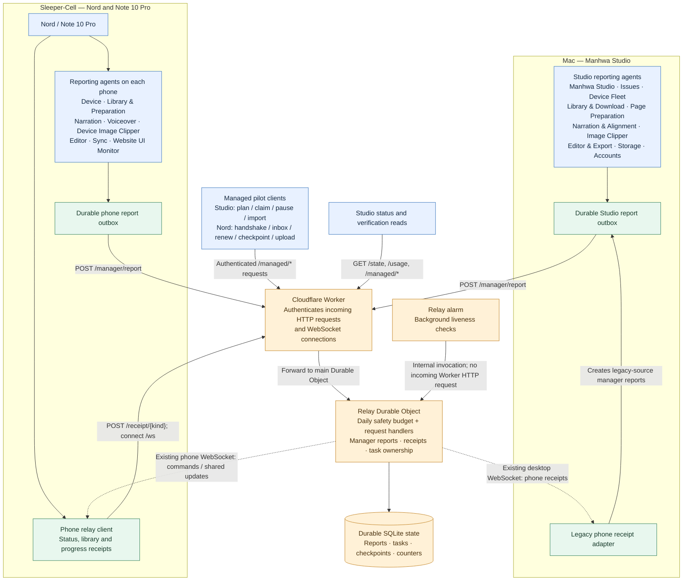

# Who sends requests to the relay

Verified against the sender metadata and transport code on 20 October 2026. Agent names are logical reporting roles inside Studio or Sleeper-Cell, not separate AI services. This diagram shows request paths, not a measured per-agent request breakdown.

- **Direct manager reporting:** Studio agents → Studio outbox → relay; phone agents → phone outbox → relay.
- **Additional forwarded reports:** phone receipt → relay → Studio's legacy adapter → Studio outbox → relay. Native and legacy sources can describe related work; they are distinguished in the journal. This is an additional path, not proof that every native report is duplicated.
- **Other traffic:** managed pilot commands/checkpoints, status reads, WebSocket connections/reconnections, and internal relay alarms.
- Dotted arrows are pushes over an existing WebSocket, not a new HTTP request for each update. Worker requests, DO invocation events and SQLite row operations are separate metrics.
- Report delivery honors the durable Retry-After pause. Phone reporting health records and Studio health-only reports are throttled; changed observations can send sooner.
- The planned **Cloudflare Manager** and **Automation Manager** currently show not reporting. The relay and managed-pilot clients still generate their own transport traffic.
- Per-agent request counts and a complete per-URL request log are not currently retained. Today's accepted source identities are in [sender evidence](relay-senders-2026-10-20.json); aggregate request metrics are in [today's report](relay-requests-2026-10-20.md).
