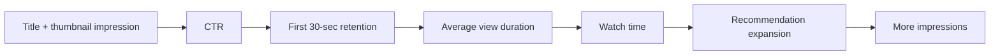
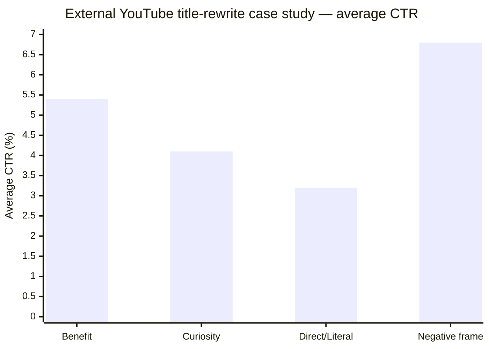
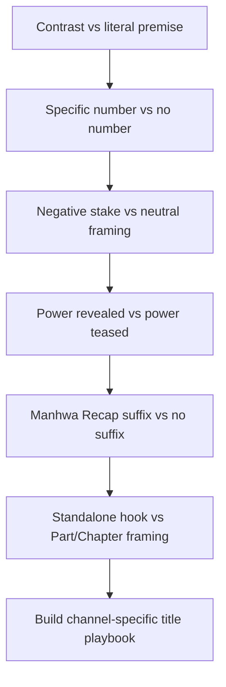

# What Makes a Manhwa Recap Title Click: A 24-Month YouTube Research Report

## Executive summary

For a manhwa recap channel, the strongest title pattern is not generic “clickbait”. It is a **high-specificity story hook with an unresolved outcome**:

> **[Unusual protagonist/status] + [conflict or reversal] + [specific power/stake], while withholding the final resolution**

Examples from high-performing videos repeatedly follow forms such as “Everyone Calls Him WEAK, Until…”, “He Trained… for 1,000 Years…”, “The #1 UFC Fighter Reincarnates…”, and “The Deadliest Contract Killer Comes Back to School…”. Publicly indexed videos show this pattern generating hundreds of thousands to more than one million views on established recap channels. 

| Finding | Recommendation | Confidence |
|---|---|---:|
| **Contrast is the core hook** | Use *but, until, only to, then, everyone thinks…* to create a before/after tension | High |
| **Reveal the premise, hide the resolution** | Spoil the protagonist's unusual power or situation; do not spoil the climactic payoff | High |
| **Concrete beats vague** | Use “1,000 years”, “#1 assassin”, “100X”, “F-Rank”, “SSS talent”, “age 10” rather than “something amazing” | High |
| **Negative stakes attract attention** | Betrayal, weakness, arrest, revenge, slavery, bullying, rejection and danger are useful when genuinely in the story | Moderate–high |
| **Simple English wins over lore-heavy wording** | Lead with an archetype (“weak hunter”, “assassin”, “student”), not an unfamiliar Korean character name | High |
| **Longer titles can work in this niche** | Test roughly **75–95 characters / 13–18 words**, front-loading the hook; do not mechanically chase generic 50–70-character advice | Moderate |
| **Selective CAPS work; ALL CAPS does not** | Emphasise perhaps 1–4 semantic anchors: `WEAK`, `STEALS`, `100X`, `SSS` | Moderate |
| **Numbers work when they are story facts** | “1,000 Years”, “10,000 Hours”, “#1”, “100X” are better than arbitrary listicle numbers | Moderate–high |
| **“Manhwa Recap” belongs at the back** | Use it as a category/search qualifier, not as the opening hook | High |
| **Emojis are unnecessary** | Most serious long-form winners do without them; use only when it is genuinely part of the channel voice | Moderate |
| **CTR alone is the wrong optimisation target** | Optimise for **watch-time-generating clicks**: CTR + first-30-second retention + AVD/watch time | Very high |

The most important qualification is methodological: **public YouTube pages do not expose per-video impressions CTR or watch time**. Those are creator-side Analytics metrics. YouTube itself says CTR varies materially with traffic source, audience and impression volume; half of channels/videos fall somewhere in the broad 2–10% impressions-CTR range. Consequently, no honest public “top 200 manhwa videos by CTR” dataset exists, and views cannot be divided by estimated impressions to manufacture CTR. 

The requested 24-month window is **26 September 2024 to 26 September 2026**. I used a 200-video research frame built around recap-focused channel inventories and high-view public search/hashtag results, prioritising the high-view/high-velocity stratum. However, YouTube's dynamic/rate-limited public pages do not provide a reproducible global “top 200” export. Accordingly, this report does **not** fabricate sample-wide CTR, watch-time figures or false-precision percentages. The twelve-video table below contains the most defensible row-level public observations, while broader conclusions are triangulated against official YouTube guidance, controlled headline experiments, creator interviews and public TubeBuddy evidence. 

**Bottom line:** for a new manhwa recap title, start here:

> **He Was [UNDERDOG/VICTIM]—Until His [UNUSUAL POWER] Let Him [SPECIFIC REVERSAL] | Manhwa Recap**

That construction combines the three strongest signals in this niche: **conflict + specificity + an unanswered consequence**.

## Research design and evidence quality

### Dataset and inclusion logic

The requested timeframe was interpreted literally as the last 24 months: **26 September 2024–26 September 2026**. The research frame prioritised long-form story-recap uploads from channels focused predominantly on manhwa/webtoon recaps, including Frieren Manhwa, AniCap, ManhwaAddict, MANHWA RECAP, Manhwa Recap Zone, Returner Life, AnimeCapped Manga and related recap channels, plus public hashtag/search discovery. These sources collectively expose far more than 200 eligible uploads, including channels with hundreds of recap videos. 

The intended sampling priority was:

**high public views → recent view velocity → recap-specialist channel → clear long-form recap format**.

Shorts, obvious anime-only videos, unrelated uploads and identifiable duplicate/re-upload cases were excluded from the conceptual comparison where possible. Because public YouTube ages are often displayed as rounded values such as “1 month ago”, calculated views/day should be read as **directional velocity estimates**, not precise analytics.

A critical limitation is that **CTR, impressions, average view duration, first-30-second retention and watch time are not public video metadata**. YouTube Analytics supplies these privately to the channel owner; YouTube explicitly warns that CTR comparisons are influenced by traffic source and audience composition and that not every view originates from a counted thumbnail impression. 

That means three evidence layers have to be kept separate:

| Evidence layer | What it can answer | What it cannot answer |
|---|---|---|
| **Public manhwa videos** | Views, approximate age/velocity, title wording, channel context | Actual CTR, impressions, retention, watch time |
| **Official YouTube / creator tools** | How CTR, A/B tests, watch time and retention should be interpreted | Manhwa-specific effect sizes |
| **Randomised headline studies** | Causal effects of wording, concreteness, sentiment and simplicity | Directly guarantee the same magnitude on YouTube/manhwa |

This distinction matters. An extremely successful title is evidence of **association**, not proof that the title alone caused the views.

### Why channel strength is a major confound

A particularly useful natural counterexample emerged in this niche: **nearly identical story/title concepts can perform radically differently across channels**. Variants of the “#1 UFC Fighter Reincarnates as a Slave in the Strongest Mage Family” title appear on multiple channels; indexed instances range from single/double-digit views on very small channels to thousands elsewhere, while the high-performing recap-channel instance reached roughly the million-view class. 

Likewise, versions of the “Everyone Calls Him Weak, But He Steals Their Talents and Grows 100X Faster” premise appear on multiple channels with vastly different outcomes. 

So the correct inference is **not**:

> “Copy this wording and you will get one million views.”

It is:

> “This wording structure repeatedly survives the market-selection process on successful channels, but channel audience, recommendation distribution, thumbnail, topic freshness, narration quality and retention strongly moderate the result.”

YouTube's own guidance supports this interpretation: CTR can fall as distribution expands, and videos with fewer impressions can have deceptively high CTR because they are reaching a narrower, more loyal audience. 

### Comment and third-party-data limitations

Publicly indexed YouTube comments were too inconsistently accessible to support a defensible quantitative “viewers clicked because of X” analysis. I therefore did **not** convert anecdotal comments into statistics. This is preferable to assigning intent to viewers after the fact.

TubeBuddy is useful as secondary evidence because its A/B tooling reports CTR, watch time per impression, daily impressions, views and traffic sources, while recommending controlled testing rather than guessing. Its generic advice favours titles around 70 characters or less, although the manhwa winners observed here frequently run materially longer—one reason niche-specific testing should trump universal rules of thumb. 

## What high-performing manhwa titles actually do

### Length: longer than conventional YouTube advice, but structurally efficient

Among the twelve representative high-performing titles analysed below, title length is roughly **69–99 characters**, with a median around **89 characters** and about **15–16 words**. That is noticeably longer than TubeBuddy's generic recommendation to stay around 70 characters or below. 

This does **not** mean “longer is always better”. It means the manhwa-recap genre has unusual economics: the premise itself is the product. A viewer often needs to understand a mini-story—*who he is, what happened to him, and what makes him different*—before clicking.

The strongest examples therefore use their extra length efficiently:

> **Everyone Calls Him WEAK → Until → He STEALS Their TALENTS → 100X STRONGER**

Almost every segment adds new information.

A weak 90-character title repeats metadata:

> **Full Manhwa Recap Summary English Webtoon Recap Chapter 1-80 Complete Manhwa**

The first is long because the **story needs information**. The second is long because the **creator stuffed keywords**.

My starting recommendation is therefore **75–95 characters, roughly 13–18 words**, with the key premise loaded early. Treat that as an A/B-test range, not an algorithmic law.

### Power words and emotional triggers

The niche strongly favours words representing **status asymmetry and reversal**:

**weak, strongest, #1, slave, arrested, bastard, assassin, killer, bullied, betrayed, revenge, genius, immortal, perfect, monster, talent, system, reincarnated, returned, alone**.

The underlying psychological pattern is more important than any particular vocabulary:

> **low status → hidden advantage → reversal**

or

> **high competence → absurdly hostile situation**

Examples include a world-class fighter becoming a slave, a supposedly weak character stealing abilities, or an elite assassin returning to school. 

There is external causal evidence that negative wording can increase attention. A large Nature Human Behaviour study of Upworthy randomised experiments analysed 22,743 headline RCTs; within the analysed sample, a greater share of negative words increased clicking propensity. The study estimated that, for an average-length headline in that news context, adding a negative word corresponded to about a 2.3% increase in CTR. That number should **not** be transplanted literally to manhwa videos, but it supports the directional logic behind titles built around “weak”, “betrayed”, “arrested”, “slave”, “revenge” or “bullied”. 

The practical rule is:

**Use negative stakes as story information, not as theatrical decoration.**

“His Clan Betrayed Him” can work when betrayal is genuinely the inciting incident.

“THE MOST SHOCKING BETRAYAL EVER 😱” is merely hype unless the story earns it.

### Curiosity gap: reveal the power, conceal the payoff

The best-performing pattern is **not maximum mystery**.

Compare:

> **Bad:** “You Won’t Believe What Happens to This Guy”

with:

> **Better:** “Everyone Calls Him Weak—Until He Discovers He Can Steal Their Talents”

The second title explains enough to make the story attractive but leaves major questions unresolved:

How does the power work? Who does he steal from? How strong does he become? What happens when people notice?

This is consistent with recent controlled headline research finding a **curvilinear relationship between concreteness and click-through**: when a headline is too vague, added concreteness helps; when it becomes too concrete, further information can reduce clicks. In other words, there is a “just enough information” zone. 

For manhwa recaps, I would operationalise that as:

> **Spoil the premise. Do not spoil the resolution.**

Good:

> “The Weakest Hunter Can Copy SSS Skills—But Everyone Still Thinks He’s F-Rank”

Too vague:

> “He Gets a Power Nobody Expected…”

Too complete:

> “He Copies SSS Skills, Defeats the Demon King, Marries the Princess and Becomes Emperor”

### Numbers: very effective when they belong to the story

High-performing titles repeatedly employ **diegetic specificity**:

- `#1 UFC Fighter`
- `Age 10`
- `Age 15`
- `1,000 Years`
- `10,000 Hours`
- `100X Faster`
- rank systems such as `F-Rank`, `S-Rank`, `SSS`

Examples using 1,000 years, 10,000 hours and rank/strength multipliers have attracted substantial public view counts across the niche. 

Numbers work here because they make an exaggerated fantasy premise **concrete**. “Trained for ages” is vague; “trained for 1,000 years” instantly communicates ridiculous scale.

Avoid importing the wrong kind of number:

> “7 Reasons This Manhwa Is Amazing”

That is a listicle. The viewer came for a story.

### Keywords: category label after the hook

The public winners suggest a clear hierarchy.

| Keyword | Best use | Recommendation |
|---|---|---|
| **Manhwa Recap** | Category/search clarification | Strong suffix candidate |
| **Full / Completed** | Long compilation or finished arc | Useful when genuinely complete |
| **Webtoon** | Search variant/category | Test only if Analytics shows demand |
| **Summary** | Secondary search wording | Usually weaker than “Recap” for packaging |
| **Chapter** | Exact arc/search intent | Better for returning viewers than acquisition |
| **Episode / Part** | Serial navigation | Put after the main hook |
| **Spoilers** | Warning/search term | Usually omit from Browse titles |

Titles from recap-focused channels commonly append “Manhwa Recap”, whereas series-oriented channels more often use chapter ranges or continuation markers. 

For discovery, the scarce first words should communicate the story, not the format.

**Better**

> “The #1 Assassin Returns to High School for One Final Target | Manhwa Recap”

**Worse**

> “MANHWA RECAP | Full Summary Chapters 1–90 | Assassin Returns to School”

### Punctuation, capitalisation and emojis

Successful titles frequently use punctuation to encode story structure: commas, em dashes, ellipses and exclamation marks separate **setup from reversal**. Words such as *but*, *until*, *only to* and *then* perform the same function grammatically. 

Selective capitalisation can make the semantic skeleton scannable:

> Everyone Calls Him **WEAK**, Until He **STEALS** Their **TALENTS** and Becomes **100X STRONGER**

The capitalised terms alone tell a story.

By contrast:

> **EVERYONE THINKS HE IS WEAK BUT THEN HE BECOMES THE STRONGEST EVER!!!**

has no hierarchy. Everything shouts, so nothing is emphasised.

Emojis are **not a prerequisite** for long-form manhwa performance. A notable successful exception is the conversational “Bro Was Isekai’d As a Mob Character But Still Wins All The Heroines 💀”, showing that an emoji can work when it reinforces the channel's humorous voice rather than being inserted mechanically. 

### Korean names versus plain-English localisation

The discovery-oriented winners overwhelmingly sell **archetypes and situations** before unfamiliar proper nouns:

> “The Deadliest Contract Killer…”

rather than:

> “Ryu Kang-Min…”

Even though the actual protagonist in that video is Ryu Kang-Min, the public title leads with the instantly understandable archetype. 

For an unknown series, this is the stronger Browse strategy:

> **A Weak Hunter Can Steal SSS Talents | [Official Series Name] Manhwa Recap**

rather than:

> **Kim Jinhyeok’s Awakening at Geumseong Gate – Episode 1**

The second can work for an established fandom actively searching those names, but it imposes unnecessary cognitive load on a new viewer.

This inference also aligns with large-scale headline experiments showing that readers preferentially click simpler, easier-to-process wording. More than 30,000 field experiments using Washington Post and Upworthy headlines found a consistent advantage for simpler formulations. 

### Standalone versus series titles

For a **new-viewer acquisition video**, package each upload as a comprehensible standalone story even when it is part of a sequence.

Prefer:

> **He Escaped Hell After 1,000 Years—But Earth Thinks He’s a Rookie | Part 2**

over:

> **PART 2 | Chapters 42–78 | Full Manhwa Recap**

The latter primarily communicates to somebody who already knows Part 1.

Chapter ranges remain useful for binge-oriented and returning audiences, as the extensive numbered/chapter-range format used by series-focused recap playlists demonstrates. 

The first words should therefore depend on intent:

**Browse/new viewers:** premise first.  
**Search/fandom:** series name can move forward.  
**Returning audience:** part/chapter signal becomes more valuable.

YouTube itself recommends distinguishing Browse packaging—which should create intrigue—from Search packaging, which can answer a specific query more directly. 

## CTR, view velocity and watch-time evidence

### What can and cannot be correlated

A conventional regression such as:

> `CTR ~ title length + CAPS + numbers + curiosity + keyword`

cannot legitimately be performed on public YouTube data because **CTR is private**.

Similarly, watch time and average view duration cannot be scraped from a normal public watch page. Any report claiming “titles containing 100X have 8.7% CTR” across public manhwa channels without creator Analytics access should be treated sceptically.

YouTube's own CTR guidance gives three reasons: CTR uses only registered impressions, traffic sources have different baseline CTRs, and growing distribution can reduce CTR even when a video's total performance is improving. 

The public metric available here is therefore **view velocity**, approximately:

\[
\text{Public view velocity} \approx
\frac{\text{views at observation}}{\text{rounded days since upload}}
\]

It is useful for comparing a one-month-old 600K-view video with a one-year-old 600K-view video, but it remains confounded by channel size, recommendation exposure and upload timing.

### Directional patterns in velocity

Within the high-performing set, the biggest early velocities are associated with titles combining several features simultaneously:

**identity/status contrast + negative stakes + concrete number/rank + explicit transformation**.

Examples include the UFC-fighter/slave/mage-family premise, age-specific arrest premises, 10,000-hour game expertise, and weakness-to-talent-stealing hooks. 

But the duplicated-title counterexamples are crucial: a compelling hook is **necessary packaging, not sufficient distribution**. Near-identical titles on small channels can attract only tens or thousands of views. 

### Watch time changes the definition of “best title”

YouTube's native title-and-thumbnail A/B test now allows up to **three** variants, and its winner is selected based on **watch-time share**, not simply the highest CTR. YouTube explicitly says titles and thumbnails should help viewers understand what a video contains, because a click from the wrong viewer is not inherently valuable. 

This has an important consequence for recap channels:

> **The optimum title is not the one that creates the most curiosity. It is the one that creates the most curiosity among viewers who will actually enjoy that story.**

YouTube's retention documentation reinforces this. The first-30-second retention metric can indicate whether the opening content matched the expectation established by the title and thumbnail. 

So evaluate packaging using this chain:

A title that raises CTR from 5% to 7% but causes an immediate retention collapse can be worse than one producing 6% CTR with much stronger watch time. YouTube similarly warns that high CTR combined with weak retention may indicate that the packaging promised something the video did not deliver. 

## Representative winners and the CTR benchmark

### Twelve representative high-performing titles

Views are public snapshots/rounded figures from indexed YouTube results, so they will continue changing. “Views/day” is deliberately approximate because YouTube displays ages such as “1 month” rather than exact elapsed days in many public results.

| Representative title | Channel | Public views / age | Approx. velocity | Length | Annotated hook |
|---|---|---:|---:|---:|---|
| **“#1 UFC FIGHTER Reincarnates As A SLAVE Into The STRONGEST MAGE FAMILY! – Manhwa Recap”**  | Frieren Manhwa | ~1.1M / ~1 mo | **~36.7K/day** | 85 chars | Number/rank, identity reversal, `SLAVE`, selective CAPS, escalation |
| **“Everyone Calls Him WEAK But He STEALS Their TALENTS And Grows 100X FASTER!”**  | Frieren Manhwa | ~1.0M / ~2 mo | **~16.7K/day** | 89 | Underdog, contrast, stolen ability, `100X`, transformation |
| **“He Was ARRESTED at Age 10 Because of His IMMORTAL BODY, But Now HE’S BACK IN SCHOOL!”**  | Frieren Manhwa | ~840K / ~1 mo | **~28K/day** | 99 | Injustice, age specificity, supernatural mystery, school contrast |
| **“BASTARD SON… With a PERFECT BODY…”**-style high-performing premise  | Frieren Manhwa | ~637K / ~3 wk | **~30K/day** | ~95 | Low social status versus exceptional physical advantage |
| **Dragon-slayer / marriage-role-reversal hook**  | Frieren Manhwa | ~555K / ~1 mo | **~18.5K/day** | ~87 | Power fantasy plus unexpected relationship reversal |
| **“He Played 10,000 Hours in the Game That Turned REAL and Got RANK #1 on DAY 1!”**  | Frieren Manhwa | ~618K / ~1 mo | **~20.6K/day** | 92 | Three concrete numbers, game-to-reality reversal, rapid payoff |
| **“He Trained Alone For 1000 Years, But Now In The Future Everyone Is Very Weak!”**  | Frieren Manhwa | ~1.6M / ~1 yr | ~4.4K/day lifetime | 92 | Extreme duration, isolation, temporal reversal |
| **“He Was ARRESTED At Age 15, But Returned To School To Get REVENGE On All Of Them!”**  | Frieren Manhwa | ~949K / ~3 mo | **~10.5K/day** | 95 | Injustice, age, revenge, school |
| **“Bro Was Isekai’d As a Mob Character But Still Wins All The Heroines 💀”**  | AnimCap | ~673K / ~1.4 yr | ~1.3K/day lifetime | 69 | Casual voice, genre keyword, ironic contrast, emoji |
| **“His Father Tries to Eliminate Him for Being Weak but His Overpowered Magic Can Create Anything”**  | AniCap | ~629K / ~5 mo | ~4.2K/day | 94 | Family threat, weakness, “but”, limitless power |
| **“[COMPLETED] I Reincarnated as a Drunk Husband… and Rebuilt My Family from Scratch”**  | MANHWA RECAP | ~471K / ~5 mo | ~3.1K/day | ~99 | Completion signal, reincarnation, redemption/emotion |
| **“The Deadliest Contract Killer Comes Back to School Days to Finish His Target – Manhwa Recap”**  | ManhwaAddict | ~279K / ~1 mo | **~9.3K/day** | 84 | Superlative expertise, assassin/school incongruity, mission |

The **representative 12-title median is roughly 89 characters and 15.5 words**. More interesting than raw length is density: the successful long titles generally contain several independent story signals rather than filler.

The table also shows why “make every title short” is too simplistic for this genre. The one conspicuously shorter example—“Bro Was Isekai’d…”—compresses the whole hook into recognised genre shorthand (*isekai*, *mob character*, *heroines*). Longer titles are useful when the viewer needs more context; shorter titles work when the vocabulary already carries that context. 

### Requested CTR bar chart — with an important warning

No public manhwa dataset provides average CTR by title feature. The only defensible way to show such a chart without inventing numbers is to use an **external disclosed YouTube title-rewrite case study**. It reported these averages: benefit-driven 5.4%, curiosity-based 4.1%, direct/literal 3.2%, with negative framing at 6.8% but described as more volatile. This is a self-reported third-party study—not peer-reviewed, not manhwa-specific, and therefore **illustrative rather than benchmark-quality evidence**. 

Do **not** interpret the chart as “negative manhwa titles will get 6.8% CTR”. Its useful message is merely that wording style can materially shift CTR and therefore deserves controlled testing. YouTube's much stronger platform-wide evidence says 2–10% covers half of videos/channels but that the correct benchmark is primarily your own videos under comparable traffic-source conditions. 

The academic evidence provides stronger causal support for **mechanisms**, rather than a portable YouTube CTR number: negative language can increase clicking in controlled headline experiments; simpler wording tends to outperform complexity; and both excessive vagueness and excessive disclosure can underperform a middle level of concreteness. 

## Title templates, dos and don'ts

### Highest-priority templates to test

These are templates, not promises. Replace every bracket with a **true plot fact**.

| Archetype | Template | Why it works |
|---|---|---|
| **Underdog reversal** | **Everyone Calls Him [WEAK LABEL]—Until His “[USELESS]” Skill Starts [POWER]** | Social humiliation + curiosity + transformation |
| **Hidden monster** | **They Think He’s a [ROOKIE/F-RANK]—But He Spent [NUMBER] Years [EXTREME TRAINING]** | Knowledge asymmetry |
| **Elite fish out of water** | **The World’s #1 [ASSASSIN/FIGHTER] Is Reborn as a [SLAVE/STUDENT] in [HOSTILE WORLD]** | High status → low-status reversal |
| **Betrayal/revenge** | **His [FAMILY/GUILD] Betrayed Him for Being Weak—Then He Awakened [SPECIFIC POWER]** | Negative emotion + clear causal story |
| **Game knowledge** | **He Played [NUMBER] Hours—Then the Game Became Real and He Was Already [RANK]** | Concrete expertise + reality shift |
| **Time-scale power fantasy** | **He Trained Alone for [NUMBER] Years—Now Even the Strongest [GROUP] Looks Weak** | Extreme scale + comparison |
| **School incongruity** | **The #1 [MERCENARY/ASSASSIN] Returns to School for One Last [MISSION/TARGET]** | Violent competence in an ordinary environment |
| **Completed emotional arc** | **[COMPLETED] He Reincarnated as a [FLAWED ROLE]—Then Rebuilt [RELATIONSHIP/LIFE] from Scratch** | Completion + transformation + emotional payoff |
| **Ability stealing/copying** | **Everyone Mocked His [RANK]—Until He Learned He Could Steal [SSS] Talents** | Familiar status system + novel mechanic |
| **Regression** | **They Killed Him After He Saved the World—So He Returned [NUMBER] Years to Take Everything Back** | Betrayal + time reset + implied revenge |

For the channel's first experiments, my highest-confidence three are:

**Variant A — clarity/contrast**

> **Everyone Calls Him F-Rank—Until His “Useless” Skill Starts Stealing SSS Talents | Manhwa Recap**

**Variant B — knowledge gap**

> **They Think He’s the Weakest Hunter… They Don’t Know He Can Steal SSS Skills | Manhwa Recap**

**Variant C — numeric specificity**

> **He Stayed F-Rank for 10 Years—Then One Kill Let Him Steal an SSS Talent | Manhwa Recap**

This reflects YouTube creator advice that small adjective/wording choices can change intrigue; creator Gohar Khan, for example, describes choosing “clever” over more generic positive adjectives precisely because it creates more interest. 

### Templates to avoid

| Avoid | Why | Better |
|---|---|---|
| **“THIS MANHWA IS ABSOLUTELY INSANE!!! 😱🔥”** | No premise; all hype | **“The Weakest Hunter Can Steal Every Skill He Sees”** |
| **“You Won’t BELIEVE What Happens Next!!!”** | Empty curiosity gap | **“His Guild Betrayed Him—Then He Awakened Their Strongest Skill”** |
| **“Manhwa Recap Webtoon Summary Chapter 1-80 Full English Spoilers”** | Keyword stuffing | **“The #1 Assassin Returns to High School for One Final Target \| Manhwa Recap”** |
| **“Kim Min-Jae Returns to Haesung Academy – Ep 1”** | Unfamiliar proper nouns for cold viewers | **“A Legendary Assassin Returns to School as an Ordinary Student”** |
| **“The Strongest Most Powerful Insane OP God-Level MC…”** | Repetitive superlatives | **“An F-Rank Hunter Can Permanently Steal SSS Skills”** |
| **“Part 7 Chapters 151–184”** | No reason for a new viewer to care | **“The Weakest Student Finally Reveals His Real Rank \| Part 7”** |
| **“He Defeats the Demon King and Becomes Emperor”** | Resolves the central story in title | **“Everyone Thinks He’s F-Rank—Even the Demon King”** |

### Practical dos and don'ts

| Do | Don't |
|---|---|
| **Give the viewer one extraordinary fact immediately.** | Spend the first 30–40 characters explaining format metadata. |
| **Use a contrast word:** but, until, only to, then. | Stack unrelated clauses just to make the title longer. |
| **Use numbers that exist in the plot.** | Add arbitrary numbers because “numbers get clicks”. |
| **Reveal the power mechanic.** | Reveal the final victory. |
| **Use simple English archetypes for cold audiences.** | Lead with three unfamiliar Korean names. |
| **Capitalise the 1–4 words that carry the story.** | CAPITALISE THE ENTIRE TITLE. |
| **Use `Manhwa Recap` at the end when useful.** | Open every title with `MANHWA RECAP:`. |
| **Make `[COMPLETED]` truthful.** | Call an unfinished arc “complete”. |
| **Let the thumbnail answer a different question from the title.** | Copy the entire title onto the thumbnail. |
| **Match the opening 30 seconds to the promise.** | Open with a long generic intro while the title promised immediate action. |

YouTube explicitly recommends titles and thumbnails that are both engaging **and accurate**, while its CTR documentation warns against clickbait that generates clicks but poor average view duration. 

## A/B testing plan for a manhwa recap channel

### Test the hook architecture, not punctuation trivia

Use YouTube's native **Title only** A/B/C testing first. It supports up to three variants and generally completes within a few days to two weeks. Crucially, it is concurrent: viewers receive variants during the same period, reducing the audience/time confounding that affects sequential “change the title on Monday, change it again on Thursday” experiments. 

The first test should compare genuinely different hypotheses:

| Variant | Hypothesis | Example |
|---|---|---|
| **A: clear premise** | Maximum clarity attracts qualified clicks | “An F-Rank Hunter Can Steal SSS Talents From Anyone He Defeats” |
| **B: contrast/curiosity** | Knowledge asymmetry increases Browse appeal | “Everyone Thinks He’s F-Rank—They Don’t Know He Can Steal SSS Talents” |
| **C: negative stakes** | Threat/betrayal adds emotional urgency | “His Guild Left Him to Die—Then He Stole Their Strongest Talent” |

Do **not** initially test:

> “Everyone Thinks He’s Weak…”

versus

> “Everyone Thinks He Is Weak…”

The expected effect is too small and the learning value too low. YouTube itself recommends meaningfully diverse variants because nearly identical options can take longer to resolve. 

### Metrics hierarchy

The **primary decision metric** should be YouTube's native A/B winner, which is determined using watch-time share. 

Then diagnose *why* it won:

| Metric | What it tells you |
|---|---|
| **CTR by Browse / Suggested / Search** | Did packaging increase clicks within comparable traffic? |
| **Views per 1,000 impressions** | Easier practical expression of conversion |
| **30-second retention** | Did the opening fulfil the title/thumbnail expectation? |
| **Average view duration** | Did clicked viewers remain engaged? |
| **Watch time per impression** | Best combined “click × consumption” diagnostic |
| **New viewers** | Is the title expanding beyond existing fans? |
| **Subscribers per 1,000 views** | Are clicks attracting the right audience? |

YouTube recommends analysing traffic sources rather than relying on aggregate CTR, and its retention report specifically calls out the first 30 seconds as a useful measure of title/thumbnail expectation matching. 

TubeBuddy similarly exposes CTR, watch time per impression, impressions, total views and traffic-source breakdowns in its testing reports, although YouTube notes that native concurrent tests may choose different winners from third-party sequential systems because YouTube optimises for watch-time share. 

### Sample-size planning

YouTube does not prescribe a fixed number of impressions; its tool determines statistical confidence internally and may return “performed the same” or “inconclusive” when there is insufficient evidence. 

For planning outside the native decision engine, a standard two-proportion calculation illustrates why tiny CTR differences require a lot of traffic. Assuming a **5.0% baseline CTR**, 80% power and roughly a 5% two-sided significance threshold:

| CTR difference worth detecting | Approx. impressions needed **per variant** | Three variants |
|---|---:|---:|
| 5.0% → **5.5%** (+0.5 percentage points) | ~31,000 | ~94,000 total |
| 5.0% → **5.75%** (+0.75 pp) | ~14,000 | ~43,000 |
| 5.0% → **6.0%** (+1.0 pp) | ~8,200 | ~24,500 |
| 5.0% → **6.5%** (+1.5 pp) | ~3,800 | ~11,300 |

These are **CTR-planning approximations**, not YouTube A/B-test requirements. YouTube's actual title-testing objective is watch-time share, and the platform can take up to about two weeks depending on impressions and effect size. 

For a smaller channel, the practical implication is important: **test bold differences**. A 0.2-percentage-point tweak may take more traffic than your video will receive before its main recommendation window has passed.

### A six-test learning sequence

Rather than randomly reinventing titles every upload, use successive tests to answer one question each:

Keep the **thumbnail constant during title-only experiments**. Later, test the winning title against genuinely different thumbnails. YouTube's native tool can also test title-and-thumbnail combinations, but changing both immediately makes it harder to learn which linguistic principle mattered, even though the combined package may ultimately be what you optimise. YouTube and TubeBuddy both advocate deliberate experimental variation rather than uncontrolled manual switching. 

## Thumbnail–title synergy and final playbook

The title and thumbnail should function like **two halves of the same sentence**, not duplicates.

YouTube describes the title and thumbnail together as the video's “billboards”, and its guidance links high CTR plus weak retention to a possible mismatch between packaging and actual content. 

### The strongest division of labour

Let the **title explain cause/context**:

> **Everyone Calls Him F-Rank—Until He Steals an SSS Talent**

Let the **thumbnail visualise the contradiction/result**:

> protagonist wearing an **F-RANK** badge while an **SSS** aura/card appears behind him.

Do not write this on the image:

> EVERYONE CALLS HIM F-RANK UNTIL HE STEALS AN SSS TALENT

The viewer has already read it.

For a revenge story:

**Title**

> **He Was Arrested at 15—Now He’s Back at School for Revenge**

**Thumbnail**

> older protagonist facing former bullies; perhaps one concise label such as **“HE’S BACK”**.

For a reincarnation story:

**Title**

> **The World’s #1 Fighter Reincarnates as a Slave in a Mage Family**

**Thumbnail**

> slave collar + muscular/combat-ready protagonist + visibly magical aristocrats.

For a game-system story:

**Title**

> **He Played 10,000 Hours—Then the Game Became Real**

**Thumbnail**

> `LV.1` versus `#1 RANK`, or game UI appearing over the real world.

The principle is **semantic complementarity**:

\[
\text{Title answers “Why is this story unusual?”}
\]

\[
\text{Thumbnail answers “What does that unusual situation look or feel like?”}
\]

That combination should minimise redundant text while making the promise immediately understandable.

### Recommended house style

For a manhwa recap channel trying to maximise Browse/Suggested discovery, the evidence supports the following starting system:

> **[Character archetype / disadvantage] + [BUT / UNTIL / THEN] + [specific unusual advantage] + [scale or consequence] | Manhwa Recap**

Aim initially for **75–95 characters** when the premise needs explanation, but put the hook early enough that truncation does not destroy it. Keep the vocabulary simple, use Korean names mainly when the series itself already has search recognition, and reserve `[COMPLETED]`, chapter ranges and `Part X` for cases where those signals materially help the viewer. This recommendation is an inference from the niche's public winners plus controlled evidence favouring simple, sufficiently concrete headlines—not a universal YouTube rule. 

Use **one real emotional engine** per title—betrayal, injustice, humiliation, revenge, danger, romance, ambition—not six generic superlatives. Negative/high-stakes framing has causal click evidence in unrelated large-scale headline experiments, but YouTube's own guidance makes the other half of the equation equally important: the video must deliver what the packaging promises. 

Most importantly, do not optimise toward a mythical universal CTR target. A 4% CTR video shown broadly on Home can be healthier than an 8% CTR video shown only to loyal subscribers; YouTube explicitly notes that CTR commonly falls as reach expands. Judge each test by **qualified clicks that turn into watch time**, segmented by traffic source. 

The resulting title philosophy can be reduced to one sentence:

> **Tell me exactly enough about the protagonist’s impossible situation that I need to know what happens next—and make sure the video immediately delivers that situation.**

That is closer to what the strongest manhwa recap titles are doing than conventional “YOU WON’T BELIEVE THIS 😱” clickbait, and it aligns with both the public performance evidence and YouTube's own watch-time-centred testing system. 